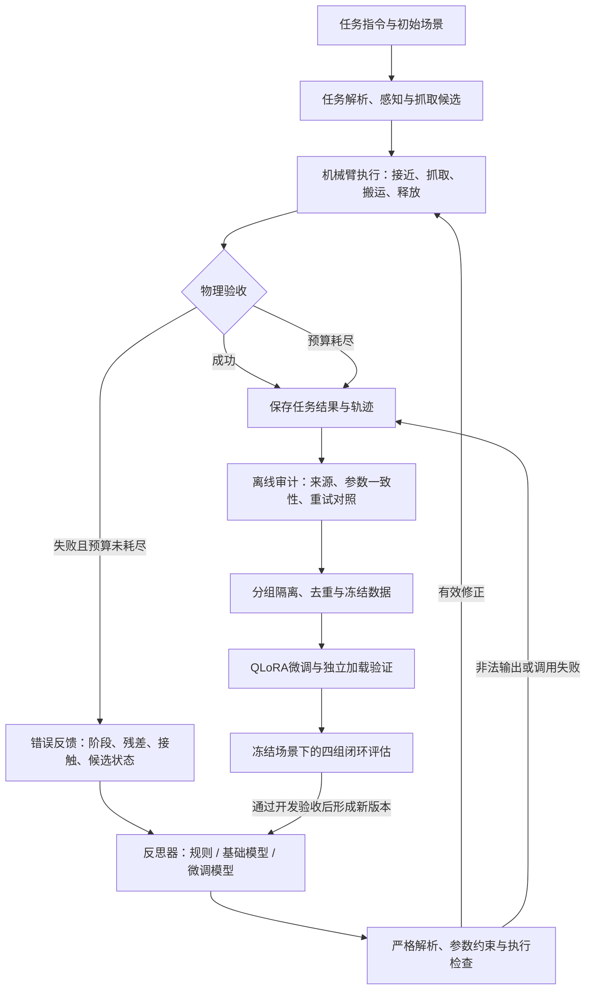

# 基于机械臂的错误反馈于智能反思系统

> 论文题目按作者提供原文保留。本仓库记录框架的设计思路、开发进度、实验计划与精选证据；完整运行源码、模型权重及全部轨迹仍在原实验环境中。

本项目研究机械臂执行失败后如何利用反馈进行修正：把“没有抓住”“搬运发生碰撞”“物体没有落入容器”等现象转化为结构化证据，由反思模块生成受约束的参数调整，再通过实际执行检查调整是否有效。

**当前已跑通“仿真执行—错误反馈—修正决策—数据筛选—小规模微调—闭环评估”流程，正在扩大规则监督数据集。** 已验证范围是 MuJoCo 仿真与文本反思；视觉链路和真实机械臂迁移属于后续工作。

## 1. 为什么开发这个框架

机械臂任务失败后，仅返回一个“失败”标记无法指导下一次动作。即使接入语言模型，生成一段看似合理的解释，也不保证修改方向正确，更不保证机械臂能恢复任务。

因此，框架围绕三个问题展开：

1. **反馈是否有用？** 不只记录错误类型，还要知道失败发生在哪个阶段、物体和目标之间有何残差、哪些候选被过滤、是否存在真实接触。
2. **修正是否可执行？** 模型只能修改明确允许的控制参数，不能直接输出任意代码或绕过执行约束。
3. **修正是否有效？** 将建议交给相同控制器再次执行，用物理验收判断结果，并与同预算直接重试比较。

这里的“智能反思”采用可验证的定义：**根据当前执行证据和历史尝试提出下一步修正，并接受外部执行结果检验。** 解释文字、JSON格式正确率和训练loss都是辅助信息，最终要看任务是否恢复。

## 2. 总体架构：在线闭环与离线学习

框架分成两条相互连接的流程。在线流程负责执行和恢复任务；离线流程从完整轨迹中提取合格监督，训练新的反思器，再返回在线流程评估。



每次实验最多三次物理尝试。原始错误、模型输出、实际使用参数和最终结果都保留，避免只有成功截图、无法追溯失败过程。

### 各模块如何协作

| 模块 | 输入与职责 | 输出 | 当前实现边界 |
|---|---|---|---|
| 任务与场景 | 将搬运指令映射到物体、容器和场景配置 | 任务身份、初始位姿、种子 | 主实验使用规则任务解析，避免指令解析差异干扰反思比较 |
| 感知与抓取 | 提供目标位置、掩码、几何候选及过滤结果 | 可执行候选与诊断信息 | 当前主实验使用仿真感知、几何抓取 |
| 执行与监控 | 驱动机械臂，监测接触、抓取与放置结果 | 逐次执行轨迹、阶段状态、物理验收 | 基于MuJoCo及现有机械臂环境 |
| 错误反馈 | 汇总运动阶段、位置残差、接触对象和候选统计 | 结构化错误报告 | 保留完整诊断，向模型投影紧凑证据 |
| 反思决策 | 根据任务、当前参数、错误和历史尝试生成修正 | `cause`与`changes` | 规则、未微调模型、微调模型可替换 |
| 参数校验 | 检查输出结构、数值合法性、允许字段与实际变化 | 可执行参数或明确失败 | 不在模型比较中隐式补规则答案 |
| 数据与训练 | 核对真实修正和执行结果，冻结训练数据并微调 | 可追溯样本、adapter、训练记录 | 当前监督来源为程序规则 |
| 实验管理 | 调度、隔离、版本冻结、恢复与统计 | 可复查的作业和结果证据 | 已运行双卡采集，四卡运行尚待实际验收 |

## 3. 开发思路：先验证闭环，再让模型学习

### 3.1 先把失败变成可分析的反馈

开发首先需要解决“失败发生在哪里”。例如抓取候选在碰撞过滤时全部被拒，与机械臂已经抓住物体但在搬运途中撞到障碍，是两个不同问题；只给模型一个“collision”标签容易导致错误修正。

目前补充了候选总数与过滤情况、运动段、指令位置、接触信息及放置验收等诊断。还将放置是否成功与最后回零动作分开，避免把末尾动作的问题错误归因于放置位置。

输入提示保留任务、当前参数和历史尝试，对完整诊断做压缩，例如将大量候选碰撞指标汇总成统计量。隐藏的故障注入标签、未来成功标签和规则答案不作为模型输入。完整原始诊断仍单独保存，便于事后审计。

### 3.2 将反思限制在明确的动作空间

反思器提出的是已有控制参数的调整，例如抓取偏移、放置偏移或抬升高度。这样可以直接核对“建议改了什么”和“下一次执行究竟用了什么”，并复用原控制器与物理验收。

当前模型输出接口包含`cause`和`changes`。解析层拒绝重复JSON键、未知字段、非有限值、空修正以及完全不改变参数的输出；允许范围由执行参数约束决定。

这一设计便于定位失败：模型调用失败、输出非法、修正方向错误、候选不足和物理执行失败分别记录。参数通过解析并不意味着动作一定成功或绝对安全，仍需执行监控与物理验收。

### 3.3 保留规则基线，明确模型的实际价值

开发早期的纯模型试采中，12项任务只得到2条合格修正，尚不足以支持批量自举。项目因此采用明确标注来源的程序规则监督路线，同时保留纯模型与混合策略的独立记录。

规则方法有两个作用：一是作为可执行修正的监督来源，二是作为强基线，检查模型是否真正有价值。当前不将“学会规则”直接解释为超越规则，也不把规则标签包装成人工专家思维链。

后续要回答的是：微调模型在未见任务组合、扰动条件或新故障下，是否比基础模型更稳定，以及相对规则是否具有可测的适应性或成本优势。

### 3.4 修复上游可执行性，避免把所有失败都归给模型

模型调整末端参数，无法解决所有上游问题。例如候选已经在过滤前后全部消失时，调整执行阶段的抓取偏移未必能够产生新的候选。

因此，开发中单独开展了几何候选、体素化稳定性、接近路径、运动学与接触监控的诊断和改进。固定体素网格等改动用于减少几何处理对场景变化的敏感性；相关开发验收不等于已经解决所有物体上的无候选问题。

主模型对照中固定这些上游模块，防止同时修改几何和模型后无法判断收益来自哪里。

### 3.5 用真实执行结果筛选监督数据

当前规则监督样本必须满足以下链条：

1. 原始轨迹中确实发生了反思，规则输出能够按同版本重放。
2. 参数合法，且下一次执行使用的参数与这次修正一致。
3. 紧接着的下一次尝试同时通过验收并取得物理成功。
4. 同一任务在相同预算下直接重试没有成功。
5. 数据保留任务、规则来源、输入、结果与对照的身份信息，完成分组隔离和去重。

首次直接成功的任务保留在完整任务记录中，但不当作反思修正样本。持续失败与非法输出也保留，不因没有导出样本而从评估分母中消失。

数据标记为`rule_expert / model=null`。当前`cause`继承原始错误消息，它不是经过独立验证的推理链；重点监督是可执行的修正参数。

### 3.6 先小规模微调，验证模型确实能接回系统

初版训练使用163条样本，目的首先是验证数据编码、答案监督、梯度更新、adapter保存与加载、模型服务和仿真调用能否连起来。

训练后先检查参数确实变化，再在独立进程中加载保存的adapter生成答案，最后把模型接回仿真闭环。这样可以区分“训练脚本结束”“模型学到标签”和“机器人任务实际恢复”三个层次。

### 3.7 把持续采集做成可恢复的实验流水线

批量采集使用Slurm分配GPU，每张卡运行两个独立任务worker，各自写入分片任务目录。当前双卡共四个worker。

曾出现Slurm step达到内存上限的问题，恢复方案改为每组任务使用新的Python解释器，完成后释放进程占用的原生内存；同时保留已完成结果、冻结身份和中断记录。具体长期内存增长位置仍未完全定位。

采集恢复与训练断点恢复是两件事：前者已实际运行；后者虽然已保存优化器、scaler和随机状态，但resume命令行入口尚未完成验证。

## 4. 使用的技术与工具

| 技术 / 工具 | 在框架中的用途 | 为什么这样选择 |
|---|---|---|
| Python | 执行编排、错误报告、反思接口、采集和训练脚本 | 可以连接仿真接口、数值计算与模型推理，并保持模块可独立检查 |
| MuJoCo、`UR5GraspEnv`及UR5e相关实现 | 机械臂抓取、搬运、接触检测与物理验收 | 提供可重复场景和可记录的执行状态；当前结果属于仿真 |
| NumPy、几何候选与碰撞过滤 | 点云/体素处理、候选诊断、初始状态与轨迹数值核对 | 将几何问题与模型决策问题分开分析 |
| Qwen3.5-4B | 读取结构化文本反馈，生成修正参数 | 已在单张V100上验证训练与推理；目前不使用图像训练反思模块 |
| PyTorch | 自动微分、混合精度、梯度累积、裁剪、优化与checkpoint | 可检查loss、梯度和真实参数更新，而不只依赖训练结束标志 |
| Hugging Face Transformers | 模型、tokenizer、聊天模板与生成接口 | 保持训练与推理的输入格式一致 |
| PEFT / LoRA | 在语言层指定投影模块中训练adapter | 减少需要更新的参数，保留基础模型并方便做启用/禁用adapter对照 |
| bitsandbytes / NF4 | 基础权重4-bit加载、FP16计算，配合QLoRA | 在V100 16GB显存条件下完成初步训练 |
| Accelerate | 参与模型加载和设备相关依赖 | 已记录环境版本；当前没有四卡分布式训练结论 |
| Python `HTTPServer`、`urllib`、JSON | 本机反思服务与仿真客户端通信 | 分离模型加载与任务执行，记录真实请求、响应和解析结果 |
| Slurm、Linux、CUDA、NVIDIA V100 | 后台任务、GPU配额、资源隔离与作业记录 | 本地电脑离线后任务仍可继续；资源是否可用以调度配额为准 |
| JupyterHub / JupyterLab | 远程终端、文件读取与实验状态检查 | 用于当前服务器管理与产物查看 |
| JSON / JSONL、SHA256、Git / GitHub | 结构化轨迹、训练记录、文件身份和文档版本 | 将实验结论对应到具体数据、源码身份和结果文件 |

初步训练实际记录的环境为PyTorch **2.6.0+cu124**、Transformers **5.20.1**、PEFT **0.21.2**、Accelerate **1.12.0**、bitsandbytes **0.49.2**，见[训练结果中的environment字段](evidence/pilot/result.json)。这是当时成功运行的环境记录，不代表任意版本组合都已验证兼容。

V100兼容处理包括NF4/FP16加载、梯度检查点、累积梯度及Qwen3.5 delta-rule的FP32保护。当前使用自定义训练循环检查有限loss/梯度、跳步和保存重载一致性；不是从头训练基础模型。

视觉相关的VLM/SAM链路属于后续独立接入和评估范围，不计入本轮已验证技术效果。

### 主要实现模块如何对应

下列为原实验环境中的模块名，供理解实现职责；它们并非都已上传到本仓库。

| 模块 | 作用 |
|---|---|
| `reflection`、`training/refine` | 错误类型、参数与反思接口、执行证据和严格解析 |
| `geometry/runtime.py`、`stability/runtime.py` | 连接执行引擎、候选记录与稳定性改进 |
| `stability/detector.py`、`monitor.py` | 固定网格体素化、接触与执行阶段监控 |
| `stability/prompt.py` | 从完整错误报告构造紧凑文本提示，保留历史尝试 |
| `expert_dataset.py`、`expert_worker.py`、`expert_audit.py` | 规则重放、配对执行、监督筛选和审计 |
| `parallel_lane.py`、`parallel_state.py`、`recovery_task.py` | GPU分片、进程隔离、冻结身份与任务恢复 |
| `sft_data.py`、`sft_model.py`、`sft_train.py`、`sft_validate.py` | 数据编码、QLoRA配置、训练与独立加载验证 |
| `loop_client.py`、`loop_service.py`、`loop_protocol.py` | 模型调用、adapter切换与四组评估协议 |
| `loop_audit.py`、`loop_results.py`、`loop_finalize.py` | 结果审计、安全汇总与本轮异常后处理 |

原环境路径与完整产物位置见[证据与复现索引](docs/EVIDENCE_INDEX.md)。本次README的代码核对范围另记于[实现检查清单](evidence/implementation_review.json)。

## 5. 目前已经完成的部分

| 工作 | 状态与证据 | 尚不能据此推断 |
|---|---|---|
| 错误反馈与受约束修正 | 已有候选、运动阶段、接触、残差及验收记录，接入严格输出接口 | 已覆盖所有失败类型 |
| 规则监督采集 | 已运行配对重试、参数一致性检查、去重与分组导出 | 每个成功任务都能成为训练样本 |
| 双卡批量与恢复 | 双卡四worker持续采集，按任务隔离进程 | 四卡运行已验收或长期内存问题已根治 |
| 初步QLoRA | 163条、1 epoch、21次更新，496个adapter张量变化 | 正式数据规模已充分 |
| 保存重载与验证生成 | 检查样本重载logits差0；48/48验证参数匹配 | 最终测试通过或复杂推理已获得 |
| 开发闭环比较 | 6场景×4组，共24次完整物理执行，结果已审计 | 大规模泛化、统计显著或优于规则 |
| 文档与证据管理 | 已形成计划、进度、路线、机器结果和hash记录 | 本仓库已包含完整可运行代码与权重 |

### 初步训练结果

基础模型为Qwen3.5-4B，采用NF4/FP16 QLoRA，rank8、alpha16、dropout0.05、学习率1e-4、seed42。冻结数据为train163 / validation48 / test38，test封存；163条训练样本各使用一次，只监督assistant答案。

同一48条验证数据的token交叉熵从 **0.4734516** 降至 **0.00001613**。保存后的模型独立加载，在48条验证输入上生成的修正参数全部匹配规则标签。


低loss和48/48说明当前规则标签模仿效果较好，不能代替物理成功率。未微调模型仅有三个预固定示例的生成对照，不能写成全部48条从0/48提升到48/48。

### 小规模闭环结果

开发评估使用两个物体—容器组合、三类持续故障、新seed40000；四组共享初始状态和最多三次尝试。基础与微调模型使用相同权重加载方式、提示及greedy解码，只切换adapter，没有额外规则回退。

| 方法 | 成功任务 | 平均尝试次数 | 无效输出 / 调用 |
|---|---:|---:|---:|
| 直接重试 | 1/6 | 2.67 | 不适用 |
| 规则反思 | 6/6 | 1.83 | 0/5 |
| 未微调模型 | 3/6 | 2.17 | 1/8 |
| 微调模型 | 6/6 | 1.83 | 0/5 |

其中一个场景四组首次均成功，没有触发反思；其余五个首次失败场景，微调模型恢复5/5、基础模型恢复2/5。当前结果与规则持平，不能据此声称总体等效或超过规则。


在红块碰撞示例中，基础模型调整抓取偏移后最终失败，微调模型选择抬升高度0.45并在第二次尝试成功。图片用于解释具体行为，完整结果仍以全部任务为分母。

原Slurm评估作业3717最终为FAILED：零模型调用场景缺少请求日志，旧汇总代码因此出错。24份物理结果完整；独立后处理补齐两份汇总并审计，原始轨迹hash未变。这个异常和恢复记录保留在仓库中，下一轮需使用新的冻结执行版本。

### 当前采集进度

以下为 **2026-10-21 21:54:14（北京时间）** 的只读快照，运行可能已继续推进。

| 项目 | 数量 / 状态 |
|---|---:|
| 任务计划上限 | 5700 |
| 已完成任务 | 1099 |
| 当前筛选样本 | 723 |
| 训练 / 验证 / 测试 | 474 / 139 / 110 |
| 训练校准 / 碰撞 / 放置 | 161 / 113 / 200 |
| 采集作业 | 3718，RUNNING，双GPU |

下一轮门槛仍为train≥1000、validation/test≥100、训练每类持续故障≥100，并通过最终来源、隔离和物理证据审计。当前验证、测试及训练类别数量已达到对应下限，训练总数还差526条。

这些是扩量批次的计数，不会改变163/48/38的pilot冻结快照。数量达标只是工程启动条件，不等于统计充分。来源见[本次采集快照](evidence/status_20261021_215414.json)及[服务器检查](evidence/server_check_20261021_215414.txt)。

## 6. 后续开发与实验安排

| 优先级 | 后续工作 | 验收目标 |
|---|---|---|
| P0 | 继续扩量、正常收尾、冻结并审计数据 | 达到数量与覆盖门槛；每条监督可追溯，跨集无泄漏 |
| P0 | 整合安全汇总，建立新冻结评估版本 | 首次成功/零调用、合法修正、非法输出、服务失败四类路径均可追踪 |
| P1 | 使用扩大数据训练第二版反思模型 | 真实参数更新、独立重载、验证生成和验证闭环均有记录 |
| P1 | 完成独立任务四组比较 | 相同初始条件、相同尝试预算、全量失败分母、效应量与区间 |
| P1 | 数据量与训练轮次实验 | 分开比较163/300/600/1000条与1/2/3 epoch，必要时追加等训练预算对照 |
| P2 | 错误反馈消融与鲁棒性 | 区分阶段信息、几何残差等贡献；检查反馈缺失和噪声影响 |
| P2 | 泛化与失败分析 | 新任务组合、新扰动档位和未见物体分别报告；定位几何与反思瓶颈 |
| P3 | 完整视觉反馈链路 | 单独评估VLM/SAM接入后的感知误差与闭环变化 |
| P3 | 真实机械臂迁移 | 在具备硬件、标定、安全约束和监护条件后开展小规模实测 |

下一步优先解决“在独立任务上是否有效”，而不是只追求更低loss或更多epoch。若模型继续与规则持平，应研究新条件适应性和成本；若规则更好，则保留规则作为实用方案并如实报告模型局限。

视觉和真机扩展需要新的数据、运行条件与实验协议。它们是发展路线，不是当前完成度的一部分。

## 7. 文档导航与仓库内容

- [详细实验计划](docs/EXPERIMENT_PLAN.md)：研究问题、实验矩阵、数据划分、消融和统计。
- [阶段进度记录](docs/CURRENT_PROGRESS.md)：训练、开发闭环与不同时间的采集记录。
- [后续路线与论文组织](docs/ROADMAP.md)：里程碑、资源安排、风险分支与章节映射。
- [证据与复现索引](docs/EVIDENCE_INDEX.md)：机器结果、异常恢复及原环境产物位置。
- [组会提纲](docs/MEETING_BRIEF.md)：初版汇报口径；其中采集数量带历史时间戳，最新进度以本页为准。

```text
README.md          框架思路、技术栈、进度与后续计划
docs/              实验协议、路线、阶段记录和组会材料
evidence/          精选JSON结果、运行快照、审计记录与文件hash
assets/            训练曲线和仿真案例图片
researchwrite/     写作依据、证据对应与审查边界
```

本仓库目前用于研究记录与证据交流，克隆后不能直接运行完整系统。模型权重、全部训练数据、完整源码和逐任务轨迹仍在原实验环境中；后续若整理可运行代码发布，需要补入口、依赖、配置、许可证核验与最小复现示例。
