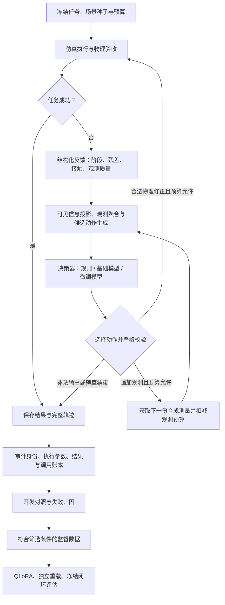

# 基于机械臂的错误反馈于智能反思系统

> 论文题目按作者提供原文保留。本仓库记录框架设计、实验进度、困难与解决方案，并公开精选证据。完整仿真源码、模型权重及全部原始轨迹仍在实验环境中；仅克隆本仓库不能重跑全部实验。

**更新日期：2026-10-28，Asia/Shanghai。** 项目已完成结构化错误反馈、受约束修正、规则监督采集、多轮小规模 QLoRA 和仿真闭环对照。当前研究重点是：**在反馈含噪、缺测且尝试预算有限时，系统如何决定“先补充观测，还是直接修正”，并通过实际执行验证收益。**

最新完成的主动观测对照中，自适应规则成功 **17/24**，固定观测策略与两种基础模型方案均为 **14/24**。这是一个开发集上的系统设计结果，尚不能归为模型能力提升。后续诊断也已完成并通过审计：11 个缺测快照中，补看 0/1/2 次后，规则下一步成功为 0/5/6，基础模型为 1/6/7。详见[当前进度](docs/CURRENT_PROGRESS.md)。

| 阅读入口 | 内容 |
|---|---|
| [当前进度与结果](docs/CURRENT_PROGRESS.md) | 已完成训练、闭环实验、最新诊断结果及状态快照 |
| [困难与解决方案](docs/CHALLENGES_AND_SOLUTIONS.md) | 研究问题、工程故障、已验证修复与仍未解决的问题 |
| [实验设计](docs/EXPERIMENT_PLAN.md) | 研究问题、对照、预算、指标与证据边界 |
| [后续路线](docs/ROADMAP.md) | 诊断 → 有针对性的修复/学习 → 独立评估 |
| [证据索引](docs/EVIDENCE_INDEX.md) | 数字来源、审计摘要、历史证据及文件身份 |
| [组会讲述提纲](docs/MEETING_BRIEF.md) | 如何解释已经做了什么、发现什么、下一步验证什么 |

## 1. 开发这个框架要解决什么问题

机械臂执行失败后，一个“失败”标记无法告诉系统应当改哪里。语言模型能给出解释，但解释是否正确、参数是否真正生效、下一次执行是否成功，需要分别验证。

因此，系统把“反思”定义为一个可检查的过程：**读取执行证据 → 选择补充信息或修正动作 → 在约束内执行 → 用外部物理结果检验决策。** 论文目标是提高机械臂任务恢复能力，同时报告额外尝试、观测与模型调用的代价。微调是实现这一目标的一种方法，其价值由闭环实验决定。

最初的问题是“模型能否根据错误调整参数”。随着实验推进，基础模型在简单候选选择任务上已接近上限，规则基线也很强。研究因此进一步细化为：

1. 反馈的阶段、残差和质量信息，是否足以支持正确修正？
2. 多次含噪测量怎样聚合，何时值得再观察一次？
3. 有限观测预算应在第一次失败用完，还是保留给后续失败？
4. 基础模型、相关历史和监督微调，各自增加了什么可测价值？

## 2. 框架怎样工作

当前实验中的“追加观测”是对仿真失败快照进行合成传感器重采样，**还不是移动真实相机或重新运行完整视觉感知**。物理尝试和观测分别计费；最新四组实验最多三次物理尝试、两次额外观测。

| 模块 | 已实现的职责 | 对实验的作用 |
|---|---|---|
| 场景与故障配置 | 固定物体—目标组合、场景种子、故障与扰动条件 | 支持同条件配对，记录场景差异 |
| 执行与验收 | 抓取、搬运、放置、接触监控及结果判断 | 以 MuJoCo 物理执行判定是否恢复 |
| 错误反馈 | 区分阶段、位置残差、候选过滤及观测质量 | 避免把所有失败压成同一个错误标签 |
| 观测处理 | 含噪/缺失测量、最新值或中位数聚合、追加观测预算 | 分离信息质量与决策器的贡献 |
| 候选与决策 | 确定性规则生成候选；规则或模型选择动作 | 保持动作空间一致并限制输出 |
| 执行边界 | 校验合法 ID、动作参数、预算和实际生效结果 | 非法模型输出计为失败，无静默规则兜底 |
| 数据与训练 | 来源标注、执行验证、分组隔离、QLoRA 与重载 | 将标签拟合和物理效果分开验证 |
| 调度与审计 | Slurm、分阶段预检、冒烟、批量、最终审计、文件哈希 | 支持后台运行并保留失败证据 |

接口也经历了演进：早期模型生成 `cause/changes`，当前候选选择实验主要输出 `{"action_id":"..."}`。允许主动观测的协议增加 `OBSERVE`。候选由规则生成，这一设计提高了可执行性，也意味着模型可能只是在选择已有补偿动作，需要强规则基线来检验增量价值。

原始故障注入真值、噪声真值、未来执行结果不作为模型输入。但错误类型和阶段仍来自理想执行器标签，这一信息假设要在后续实验中进一步放宽。

## 3. 框架是如何逐步开发出来的

### 第一步：先把失败记录准确

补充候选过滤、运动阶段、接触对象和放置验收信息，区分“没有可执行候选”“抓取偏差”“搬运碰撞”和“放置失败”。上游几何或路径问题单独诊断，避免把执行器缺陷全部归因于模型。

对外提供紧凑反馈，对内保留原始执行记录；同时核对“模型建议的参数”与“下一次实际执行的参数”。这一层是后续数据筛选和公平对照的基础。

### 第二步：建立可追溯的数据，而非只收成功文本

早期纯模型试采的合格率不足，后续采用明确标注的规则专家/混合监督路线。样本需对应实际失败、合法修正、参数生效与执行后果；规则来源与模型来源分别记录。

首次成功的任务保留在评估分母，但不能直接当作反思修正样本。失败、非法输出和无收益修正也保留。一个动作被模型选中，不等于可以成为成功标签。

### 第三步：完成微调与接回系统的全流程

已完成三种小规模训练版本：

| 版本 | 规模与更新 | 已完成验证 |
|---|---|---|
| 早期参数修正 pilot | 163 条，1 epoch，21 次更新 | adapter 保存/重载、48 条验证、6 条件闭环 |
| 候选选择器 `candidate_sft_v2` | 159 条，1 epoch，20 次更新 | 496 个 adapter 张量变化，独立重载与开发诊断 |
| 多成功动作监督 `set_sft_v1` | 189 个输入、197 个回复，1 epoch，24 次更新 | 监督集合评估、重载、与旧 adapter 的闭环对照 |

这些数据版本的任务与监督定义不同，不能相加作为一个数据集，也不能直接画成只改变数据量的学习曲线。当前训练对象是 **Qwen3.5-4B 学生模型**；服务器中称为 Flash-Next 的模型保留教师/推理基线角色，没有宣称完成其本体微调。

### 第四步：加入场景变化与噪声，检验微调是否真有用

后续 60 个开发条件涵盖场景扩展与困难案例，并对规则、基础 4B、159 样本模型和 189 输入模型进行同预算闭环比较：

| 方法 | 成功 / 条件 | 成功率 |
|---|---:|---:|
| 规则 | 57/60 | 95.0% |
| 基础 Qwen3.5-4B | 55/60 | 91.7% |
| 159 条微调 | 56/60 | 93.3% |
| 189 输入微调 | 56/60 | 93.3% |

共 240 条方法轨迹，未跳过条件。两种微调都只比基础模型多成功 1 个条件，新增训练版本没有进一步提高成功率。60 条件共享 6 个批次内种子组，属于开发对照，不能宣称统计显著或最终泛化。

这使下一步的重点从“继续增加 epoch”转向“找到能区分策略的决策困难”。

### 第五步：将信息质量与模型能力分开

`observation_model_control_v1` 在 24 条件、96 条轨迹上比较最新测量与中位数聚合。三次尝试内，最新值方案成功 22/24，中位数方案 24/24；使用规则还是基础模型，结果相同。

进一步只读审计发现，45/45 次模型决策都与同输入下的规则选择一致，且每次菜单仅有一个基于测量的补偿候选。这说明该实验首先支持观测聚合的价值，尚不能作为模型独立推理优势的证据。45 次选择之后只有 36 次下一步成功，也不能把全部选择直接导出为正样本。

### 第六步：研究何时观察，以及历史是否有帮助

最新完成的 `active_observation_model_v2` 使用 24 条件、6 个种子组、96 条轨迹，对比四种策略：

| 方法 | 三次尝试内成功 | 成功率 | 方法内物理尝试 | 额外观测 | 任务模型调用 |
|---|---:|---:|---:|---:|---:|
| 固定首次补看 `fixed_first` | 14/24 | 58.3% | 64 | 46 | 0 |
| 自适应规则 `adaptive` | 17/24 | 70.8% | 64 | 43 | 0 |
| 基础 4B 当前窗口 `base_current` | 14/24 | 58.3% | 65 | 0 | 41 |
| 基础 4B 加历史 `base_history` | 14/24 | 58.3% | 65 | 0 | 41 |

自适应规则多成功 3 个条件，即 **12.5 个百分点**，同时少用 3 次额外观测。三个差异条件中，它把一次观测留到第二次失败、缺测时使用，恢复测量后完成修正；固定策略此前耗尽观测预算。

两个模型共 82 次任务决策，输出均合法，却都没有选择 `OBSERVE`；加入历史没有提高本轮成功率。模型使用的实际观测费用也更低，比较时必须同时报告这一差异。

本轮审计通过，28 项篡改拒绝检查通过。总计 210 次唯一物理执行；表内方法尝试包含共享初态的重复记账，不能直接相加解释为实际独立执行次数。2 次模型启动回放另计。原失败版本的 11 次执行保留在工程记录中，未混入本轮结果。

这些结果支持继续研究观测分配，但各方法此前的动作和状态可能不同，不能把全部成功差异直接解释为“同一失败状态下，多观察一次”的因果效应。

## 4. 最新完成：观测决策诊断

`observation_decision_diagnostic_v2` 已完成，用于排查模型不选择追加观测的原因：

- **动作表示**：原提示在合法 ID 中列出 OBSERVE，但候选列表没有它的完整条目。比较原提示、统一候选首位、统一候选末位。
- **指令遵循**：另设“缺测且有预算先观察”的显式指令组。它属于专家策略注入，结果不能当成自主反思能力。
- **费用理解**：检查模型能否读取观测许可、观测成本、物理成本和剩余预算。
- **信息实际价值**：全部 11 个符合条件的缺测快照，分别固定补看 0/1/2 次，由同一规则或同一基础模型选择下一步动作。

实际完成 **402 次任务模型请求 + 2 次启动回放、66 个单次物理重试分支及66次物理执行**。单 GPU 模型诊断与审计后释放模型资源，再执行四 GPU 物理阶段；最终审计5391通过，4项模型和12项物理篡改拒绝检查通过，非法输出0。

截至 2026-10-28 23:19（Asia/Shanghai），整轮状态为 completed，最终审计 passed/complete 均为 true。模型阶段中，原提示和两种统一候选表示各为 0/82 次选择 OBSERVE；明确指令组为 82/82；显式费用读取为 39/41 完全正确。

| 固定追加观测次数 | 规则：下一次重试成功 | 基础4B：下一次重试成功 | 每个选择器的总额外观测 |
|---|---:|---:|---:|
| 0 | 0/11 | 1/11 | 0 |
| 1 | 5/11 | 6/11 | 11 |
| 2 | 6/11 | 7/11 | 22 |

这批固定缺测快照中，追加观测提高了下一步成功数，但增加观测仍不能解决全部失败。仅补全候选表示未触发自主观测；明确指令改变行为，但该提示组没有完整自主闭环效果结论。后续应检验观测触发条件和成本，再考虑针对性监督。见[最终诊断证据](evidence/20261028/diagnostic_completed.json)。

这里的物理诊断固定源失败快照与场景种子后重置并重试一次，并非恢复仿真失败瞬间；报告的是“下一次重试成功”，不能与完整三次闭环成功率混用。

## 5. 使用的技术与工具

| 技术 / 工具 | 实际用途 |
|---|---|
| Python、NumPy | 实验编排、反馈投影、候选生成、指标与审计 |
| MuJoCo、UR5 系列仿真环境 | 抓取/搬运/放置、接触检查与物理验收 |
| Qwen3.5-4B、Transformers | 基础决策器、聊天模板、受限候选选择 |
| PyTorch、PEFT/LoRA、bitsandbytes | NF4/FP16 QLoRA、答案监督、adapter 训练与切换 |
| SDPA 与 V100 兼容处理 | 训练显存控制、注意力实现与数值精度保护 |
| HTTP/JSON 模型服务 | 分离推理与仿真，记录请求、响应和实际选择 |
| Slurm、Linux、CUDA、V100 | 作业资源隔离、后台编排、分阶段执行 |
| JupyterHub/JupyterLab | 远程检查任务和读取产物 |
| JSON/JSONL、SHA256、Git/GitHub | 结构化轨迹、冻结身份、原始证据与文档版本 |

159/189 训练产物记录的环境为 PyTorch 2.6.0+cu124、Transformers 5.20.1、PEFT 0.21.2、Accelerate 1.12.0、bitsandbytes 0.49.2。这是对应成功作业的环境记录，不是任意组合的兼容性保证。

单 GPU 模型阶段与多 GPU 仿真阶段按实验需要分配；四卡能用于并行任务不等于做过四卡分布式训练。资源通过 Slurm 使用，不以显存空闲替代调度授权。

## 6. 遇到的主要困难与目前方案

| 困难 | 当前处理 | 状态 |
|---|---|---|
| 纯模型合格修正不足 | 规则/混合监督分开标注，执行后果筛选 | 数据与训练链路已跑通，标签质量仍需逐批审计 |
| 简单任务基础模型已经很强 | 强规则基线、困难场景、噪声/缺测与机制对照 | 已确认微调收益有限，继续定位真实能力缺口 |
| 候选生成可能代替模型完成核心推理 | 逐请求核对可见输入、候选结构和所选动作 | 45/45 一致已查明；后续需更有区分度的任务 |
| 不知道收益来自反馈还是模型 | 固定聚合方式比较选择器，再固定选择器比较观测 | 聚合与固定观测诊断已完成，独立策略验证待做 |
| 模型从不主动观察 | 统一动作表示、位置对照、显式指令和费用探针 | 诊断完成：补全表示仍不观察，明确指令可触发；根因仍需进一步定位 |
| 训练显存/数值兼容 | 量化、兼容注意力、精度保护、保存重载检查 | 当前 4B 小规模训练已验证 |
| 后台运行中断与环境耦合 | 预检→冒烟→审计→批量；依赖按阶段隔离；失败停后继 | 已修复具体故障，原失败记录保留 |
| 仿真结果与真实系统有差距 | 明示合成噪声、理想标签和仿真边界 | 真实视觉与真机验证尚未完成 |

具体故障、证据和解决边界见[困难与解决方案](docs/CHALLENGES_AND_SOLUTIONS.md)。

## 7. 下一步怎样推进

1. **把诊断转成可验证的策略改进**：诊断与审计已完成；下一轮预先冻结观测触发条件，覆盖需要与不需要观测的独立开发条件，报告成功率与费用。
2. **根据结果选择修复路径**：表示问题先修接口；信息无价值先改观测设计；能理解但不会合理决策时，再构建具有物理后果证据的训练目标。
3. **有针对性扩量和训练**：明确规则/教师/执行验证来源，按场景与种子隔离；数据规模、监督方式和训练轮数分别对照。
4. **冻结版本做独立评估**：强规则、基础模型、微调模型、观测/历史消融、成本与失败案例；最终盲测不用于反复调参。
5. **扩展现实性**：逐步弱化理想错误标签，接入真实视觉观测；满足硬件和控制条件后再开展真机验证。

现阶段可以形成系统实现、数据构建、微调对照、观测机制实验和失败分析等论文内容。当前证据尚不足以宣称模型超越规则、统计显著提升或真实机械臂泛化。

---

所有结果均对应各自冻结协议；不同实验的条件数、监督样本数、方法轨迹数与物理执行数不可直接相加。2026-10-21 的原始训练与采集材料保留在历史证据中，旧版叙述可查阅 [4113c24 版本](https://github.com/yeliheng-010/robotic-arm-reflection-thesis/tree/4113c24)。最新结论以本页和带日期的进度/证据文件为准。
