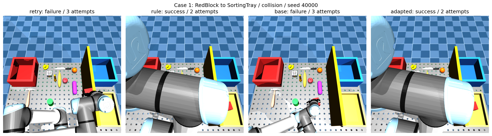

# 基于机械臂的错误反馈于智能反思系统

> 论文题目按作者提供原文保留（含“于”字）。本仓库是研究计划和进度证据仓库，并非完整可运行系统或最终论文。

研究主线：**机械臂执行 → 错误反馈 → 智能反思 → 参数修正 → 再执行与闭环验证**。微调是实现反思模块的一种方法，论文同时需要验证反馈质量、修正有效性和整个系统的任务恢复能力。

**当前阶段：初步 QLoRA 微调和小规模仿真闭环对照已完成，正在扩大规则监督数据集。**

状态快照：**2026-10-21 19:49:58，Asia/Shanghai（北京时间）**。后续运行可能已继续推进，请勿把快照视为实时监控。

## 阅读顺序

1. [详细实验计划](docs/EXPERIMENT_PLAN.md)：研究问题、方法、对照、数据划分、指标和消融。
2. [当前进度](docs/CURRENT_PROGRESS.md)：已完成、正在进行、未完成及结果边界。
3. [后续路线与论文写作](docs/ROADMAP.md)：里程碑、资源安排、风险分支和章节结构。
4. [证据与复现索引](docs/EVIDENCE_INDEX.md)：JSON、作业记录、图像和服务器产物位置。
5. [组会讲述提纲](docs/MEETING_BRIEF.md)：可直接使用的汇报内容。

## 已验证的初步结果

| 项目 | 结果 | 范围 |
|---|---|---|
| 基础模型 | Qwen3.5-4B | 文本反思输入，非端到端多模态微调 |
| 初步训练 | 163 条，1 epoch，21 次更新 | NF4/FP16 QLoRA；规则专家监督 |
| 保存后验证生成 | 参数匹配 48/48 | 验证集规则模仿，不是最终测试成功率 |
| 仿真闭环对照 | 微调 6/6；基础 3/6；规则 6/6；重试 1/6 | 6 个开发场景，4 组，共 24 次执行 |
| 当前扩量 | 完成 854/5700 个任务；训练364、验证109、测试83 | 共556条筛选样本；仍须最终审计 |

当前不能声称优于规则教师、统计显著、跨物体泛化、真实视觉性能或真实机械臂有效性。6/6 是小规模开发结果。

## 下一步决策

先将训练数据扩至至少1,000条并通过来源与执行证据审计，再冻结新版训练；随后在独立、同预算的任务集合上比较四种方法。优先补独立场景与失败类型覆盖，不因为训练 loss 很低就增加轮次。

正式门槛是工程启动条件，不是统计充分性保证。数据条数、任务数、任务族数和模型调用数分开记录。

## 仓库边界

- 仿真平台为 MuJoCo，现阶段使用仿真感知隔离反思机制。
- 当前数据标注为 `rule_expert / model=null`；纯模型与混合监督必须另建版本、单独报告。
- 原闭环 Slurm 作业3717为FAILED；24份物理结果完整，后处理恢复汇总并审计，见证据索引。
- 上传精选结果、验证记录及图像；模型权重、完整数据集、完整运行源码与逐任务轨迹仍在原实验环境中。
- 本仓库不包含服务器登录凭据，也不自动触发训练或采集。
- 写作流程使用 researchwrite，完成前执行事实、链接、文件和上传核验；不是独立专家审稿。
