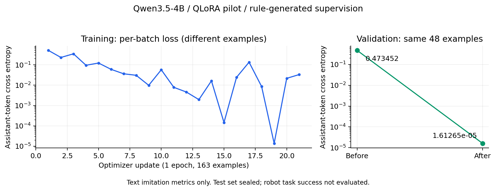

# 当前进度与已验证结果

论文题目：《基于机械臂的错误反馈于智能反思系统》（按作者原文保留）。本次题目对齐不代表新增训练或实验结果。

## 最新补充：2026-10-21 21:54:14

只读检查确认3718仍以双GPU运行；已完成1099/5700个任务，当前筛选样本723条（训练474、验证139、测试110），训练三类故障分别161/113/200。训练总数距1000条还差526条；验证、测试及训练类别数量已达到对应下限，最终质量审计仍待完成。

本次主要扩写README中的开发思路、技术栈和模块关系，没有新增训练或闭环实验。快照见[最新采集记录](../evidence/status_20261021_215414.json)，代码核对范围见[实现检查清单](../evidence/implementation_review.json)。原pilot数据和下文历史快照不变。

## 以下为首版详细记录

快照时间：**2026-10-21 19:49:58，Asia/Shanghai**。下文“当前”均指这一历史时间；最新采集数量以上方补充为准。

## 1. 当前处于哪个阶段

项目已经完成从失败证据采集、规则修正筛选、文本QLoRA训练、保存加载到仿真闭环评估的初步流程。当前主要任务是扩大数据覆盖并准备独立评估，尚未完成可支撑泛化结论的正式论文实验。

| 工作 | 状态 | 已有成果 | 尚缺 |
|---|---|---|---|
| 仿真执行与失败证据 | 已有实现和多轮诊断 | 故障、阶段、参数、物理验收与轨迹 | 全部IK路径与视觉链路覆盖 |
| 规则监督导出 | 已运行 | 来源隔离、执行一致性与配对重试筛选 | 扩量后完整审计 |
| 初步QLoRA | 已完成 | 163条、1epoch、21次更新 | 大数据学习曲线、重复训练稳定性 |
| 独立加载与生成 | 已完成 | 验证48/48参数匹配 | 全量未微调生成基线与最终测试 |
| 开发闭环对照 | 已完成并恢复汇总 | 6场景×4方法=24次执行 | 大规模封存任务、统计不确定性 |
| 扩大数据集 | 进行中 | 854任务、556条筛选样本 | train1000与类别覆盖、最终审核 |
| 泛化/消融 | 待执行 | 已制定协议 | 新任务族、新扰动、证据消融 |
| 完整视觉与真机 | 未验证 | 存在后续接入路线 | 多模态端点、可执行链路、真机条件 |

## 2. 初步微调

冻结数据为train163 / validation48 / test38。三个split与后续扩量分开保存，test未用于该模型开发评估。

| 项目 | 已记录结果 |
|---|---|
| 模型 | Qwen3.5-4B |
| 方法 | NF4/FP16 QLoRA，rank8、alpha16、dropout0.05 |
| 学习率与随机种子 | 1e-4，seed42 |
| 训练预算 | 1 epoch，梯度累积8，21次有效更新；尾批3条 |
| 监督 | 仅assistant答案；rule_expert/model=null |
| 数据使用 | 163条各一次，无截断；最长训练1344、验证1438 tokens |
| 参数更新 | 496个adapter张量变化 |
| 同48条验证loss | 0.4734516127 → 0.0000161265 |
| 保存重载检查 | 检查样本logits最大差值0 |
| 独立加载生成 | 48/48含changes JSON；48/48参数匹配规则标签 |
| 作业 | 3712 COMPLETED，0:0，6分05秒；3714 COMPLETED，0:0，6分40秒 |

训练每一步的批次不同，不能用首尾loss直接表示同一批数据提升。极低验证loss反映当前规则标签易模仿，不能代替机械臂任务成功率。

未微调生成只做过3个预先固定示例，参数匹配0/3→3/3；未对48条全部做训练前生成，因此不能写“从0/48到48/48”。已保存optimizer/scaler/RNG/order，但训练resume CLI尚未实现与验证。

## 3. 小规模闭环结果

配置：RedBlock→SortingTray与GreenCylinder→RedBin，各三类持续故障；新seed40000，validation任务组。每场景四组共用初始状态和最多三次尝试。base/SFT共享NF4基础权重、提示与greedy解码，仅切换adapter，无规则回退或JSON修补。

| 方法 | 成功/任务 | 成功率 | 平均尝试次数 | 无效输出/调用 | 服务错误 |
|---|---|---|---|---|---|
| retry | 1/6 | 16.7% | 2.67 | 不适用 | 0 |
| rule | 6/6 | 100% | 1.83 | 0/5 | 0 |
| base | 3/6 | 50% | 2.17 | 1/8 | 0 |
| adapted | 6/6 | 100% | 1.83 | 0/5 | 0 |

其中圆柱碰撞场景四组均首轮成功，没有触发反思。其余5个首轮失败场景：retry0/5、rule5/5、base2/5、adapted5/5。微调新增成功包括红块碰撞、红块放置、圆柱放置。

红块碰撞例中，base修改grasp_offset后最终失败；adapted选择lift_height=0.45，第二次成功。完整分母保留全部6场景，不能只展示改善案例。

这批仅证明小规模同族开发场景中有改善信号；尚未证明总体显著、跨物体泛化、优于规则或真实机器人效果。

### 作业失败与物理结果的区别

Slurm3717最终状态为FAILED（1:0，14分30秒）。原因是两组首轮成功、零调用场景没有requests.jsonl，旧汇总代码仍尝试读取。24份原始物理result全部完成；独立后处理补回两份汇总并做全量审计，原始轨迹SHA256保持不变。

因此准确表述是“物理评估完整，汇总异常经可追溯后处理恢复”，不能写“3717正常完成”。下一轮必须新建冻结版本、整合安全汇总，并验证零调用路径。

## 4. 当前批量采集

来源：[status_snapshot.json](../evidence/status_snapshot.json)。

| 项目 | 当前值 |
|---|---:|
| 计划任务上限 | 5700 |
| 已完成任务 | 854 |
| successful_expert_tasks字段 | 655 |
| 筛选监督样本总数 | 556 |
| 训练 / 验证 / 测试 | 364 / 109 / 83 |
| 训练校准 / 碰撞 / 放置 | 122 / 89 / 153 |
| invalid / calls累计字段 | 5 / 998 |
| sample_count_gate | false |

655个专家成功任务不是655条可训练修正；首次成功或不满足筛选条件的任务不会导出。556条是当前导出统计，还需停止后完整审计。invalid字段属于数据/调用质量统计，不等于采集worker崩溃。

距当前数量门槛：训练还差636条、测试还差17条、训练碰撞类还差11条；验证条数已达到100，但质量门禁尚未完成。`training_started=false`指原正式批次标志，不否定已完成的独立pilot训练。

## 5. 资源与稳定性

作业3718 RUNNING，运行3小时35分；双V100、每卡2个独立仿真worker。GPU2/3显存约1.9/1.4GiB，瞬时利用率低不代表停滞，需结合任务计数和日志判断。

GPU0/1显存空闲，但root的3414/3630仍占两个gpu:svc调度配额。当前只使用Slurm实际分配的双卡，不绕过调度器，不把四卡空显存当四卡可调度。

历史3688为Slurm step内存上限失败。恢复方案按任务启新解释器释放原生内存，每lane24GB、双卡总64GB；短验收不等于已定位或根治长期内存增长。

## 6. 可以与不可以汇报的结论

可以：初步训练与闭环流程已跑通；在6个开发场景中SFT6/6、base3/6；当前和规则同为6/6；正在扩充可追溯的规则监督数据。

不可以：模型已经超越专家；论文实验全部完成；生成格式正确等于任务成功；测试集已通过；多模态理解已提升；真实机械臂已验证；仅靠增加轮次就能解决泛化。
