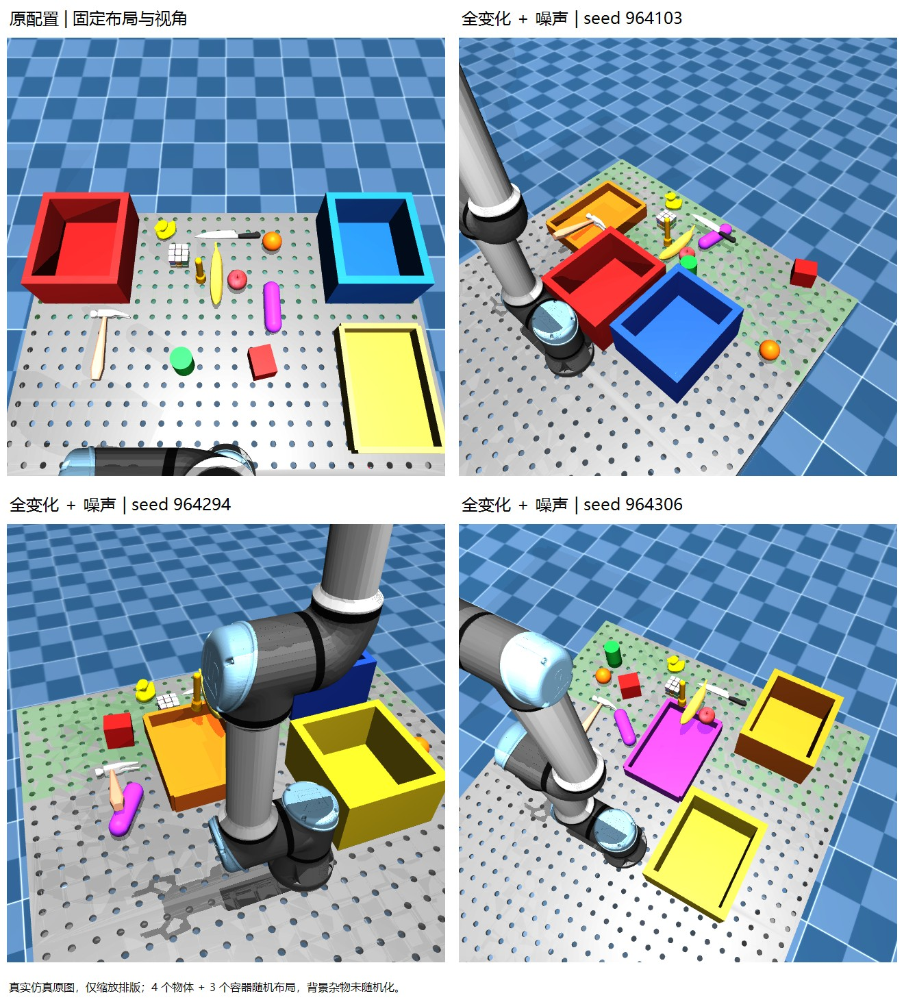

# 本周进展：从固定桌面走向随机布局、随机视角与视觉反思训练

更新截点：**2026-11-04 14:52:40 Asia/Shanghai / 2026-11-03 22:52:40 America/Los_Angeles**。本页用于本周组会，后台训练进度以该截点为准。

**本周完成了大范围场景随机化、真实视觉决策链路和十批自然失败数据采集，并已进入受控微调。** 但还没有证明微调后的模型效果提升；当前随机布局覆盖4个几何物体和3个容器，**桌面全部背景物件随机化仍未完成**。

## 1. 先看真实截图：实验环境发生了什么变化

**图怎么讲：** 左上是原配置；另外三格均是“全部已启用变化 + 深度噪声”的增强场景，分别来自不同种子。可以直接看到箱子位置与配色变化、方块/圆柱/胶囊/小球重新摆放，以及相机从桌面不同方向、不同高度观察的差别。左下机械臂遮挡明显，说明改变视角会带来真实感知困难，并不是给原图做旋转。

这张图只含两种正式场景：**baseline、varied_noisy**。三个增强示例不是三个中间档位。

| 画面 | 原图及来源 | 相机方位偏移 / 仰角 / 垂直视场角 |
|---|---|---|
| 左上：原配置 | [固定布局原图](../assets/weekly_20261104/baseline_960102.png)，两场景冒烟预览 | 固定相机 |
| 右上：种子964103 | [本轮真实观测](../assets/weekly_20261104/varied_964103.png)，第四批训练样本引用的执行前RGB | +41.24° / 51.30° / 57.39° |
| 左下：种子964294 | [本轮真实观测](../assets/weekly_20261104/varied_964294.png)，第十批训练样本引用的执行前RGB | −19.56° / 44.15° / 48.78° |
| 右下：种子964306 | [本轮真实观测](../assets/weekly_20261104/varied_964306.png)，第十批训练样本引用的执行前RGB | +28.78° / 63.82° / 57.37° |

四张都是已有仿真输出，拼图仅缩放、加标题，未合成或移动画面中的物品。三个增强原图的SHA256均与正式导出6184登记的训练图像身份一致。示例用于说明外观变化，**不是四个同条件性能对照，也不代表所有场景均无遮挡**。噪声作用于深度观测，RGB没有人为加模糊；不能凭彩色截图直接看到3 mm深度噪声。

### “全部随机摆放”目前到底实现了多少

| 对象/因素 | 当前实际实现 | 尚未覆盖 |
|---|---|---|
| 4个几何物体 | RedBlock、GreenCylinder、PurpleCapsule、OrangeSphere的位置与绕竖直轴朝向随机 | 水果、刀、锤子、魔方、小鸭等背景物件仍固定 |
| 3个容器 | BlueBin、RedBin、SortingTray分别重新采样位置，可改变相对排列 | 容器朝向保持固定 |
| 容器外观 | 红、蓝、绿、黄、橙、紫六色采样，并变化亮度；身份与显示颜色分开 | 4个几何物体仍保留原颜色；物理材质/摩擦/质量随机化未接入本轮 |
| 相机 | 位置、方位、仰角、观察目标、距离、视场角随种子变化 | 当前OBSERVE只在同一暂停状态、同一相机重采样，不是主动换视角 |
| 观测噪声 | 深度高斯噪声σ=3 mm，缺失概率2% | 未声称真实相机标定或真实传感器验证 |

因此当前准确表述是“**7个指定实例的大范围随机布局 + 随机视角 + 配色与深度噪声**”，不能写成“桌面每一件物品都已随机化”。这也是距离最初“所有物品全部随机摆放”要求仍需补齐的范围。

### 不是小幅抖动，而是改变任务几何关系

位置在桌面世界坐标X=0.85–1.55 m、Y=0.08–1.10 m区域内提案，随后受桌面边界、物体占用、间距和任务可行性约束；不是每个点都会被接受。早期12个新布局中，7实例共84次移动，实测位移16.3–99.3 cm，中位47.5 cm。

相机初始提案方位偏移±60°、仰角35°–75°、距离为基准的0.8–1.3倍，观察目标XY各偏移±10 cm，垂直视场角48°–65°。本轮正式训练自然失败现场实际覆盖：方位−56.90°至+56.85°、仰角35.28°–74.51°、距离0.909–1.448 m、视场角48.14°–64.96°。这是筛选后的范围，不能解释为均匀覆盖。

## 2. 随机化之后，系统和模型的效果怎样

### 2.1 固定场景的高成功率，不能直接推广到随机场景

早期12个新种子×2任务×2场景的48条件完整验证：

| 场景 | 计划条件 | 进入执行 | 可见性资格拒绝 | 成功 |
|---|---:|---:|---:|---:|
| 原配置 | 24 | 24 | 0 | **24/24（100%）** |
| 全变化 + 噪声 | 24 | 14 | 10 | **5/24（20.8%）** |

增强场景按进入执行的分母为5/14（35.7%）；必须同时保留完整计划分母5/24。已执行的9个失败包括碰撞4、逆运动学失败2、空抓1、定位出画1、掉落1。

**这里没有语言模型调用，衡量的是当时感知—抓取—搬运执行链的鲁棒性。** 结果说明此前固定位置、固定相机容易掩盖可见性、姿态转换、碰撞和释放问题；不能把它写成“微调模型准确率从100%降到20.8%”。

### 2.2 接入真实视觉后，基础模型仍没有超过强规则

后续安全视觉小批实验让固定规则、AI直接决策、AI诊断决策共享初次执行和动作权限，AI读取真实before/latest两图与公开执行事实。Qwen3.5-4B基础模型关闭adapter。

| 场景 | 条件数 | 首次成功 | 规则最终成功 | AI直接最终成功 | AI诊断最终成功 |
|---|---:|---:|---:|---:|---:|
| baseline | 2 | 2 | 2 | 2 | 2 |
| varied_noisy | 5 | 3 | **5** | **3** | **3** |

两个自然失败现场都能通过实际顶面抓取修正恢复，但两种AI都未恢复。全批实际执行13次、真实视觉模型调用14次。

这说明小批中存在“**动作可执行、现场可恢复，但基础模型没有选中**”的问题；仅让模型多写诊断并没有在本批带来收益。样本很小、条件与前面的48条件不同，不能把5/5与此前5/24连起来宣称成功率提升，更不能据此证明所有场景下规则都优于AI。

### 2.3 扩量后，先确认模型有可学习缺陷，再训练

正式开发集42个自然失败快照，加12个完成状态输入，共54个模型输入。基础模型实际输出为提前STOP22、完成后STOP11、未测动作21；固定规则为已测成功19、完成后STOP5、未测动作22、已测失败8。

其中**9个独立开发种子、11个快照**存在已测成功选项，同时基础模型有符合准入判据的缺陷，超过原“至少3独立种子”的门槛。未测动作仍记unknown，不能算失败；这一步是离线已测动作对照，新增物理尝试0。

**当前结论：有证据支持启动微调，但还没有微调后优于base或规则的证据。**

## 3. 本周怎么改：每项改动改善了哪一层

| 遇到的问题 | 做了什么 | 已验证效果与限制 |
|---|---|---|
| 换视角后目标出画或被挡 | 按当前任务检查源物体/容器可见性，加入完整入画边距和深度一致性，固定预算内选首个合格视点 | 同24增强条件的资格通过14→22；成功仍5，3收益与3退步相抵。改善可见性，不等于提高搬运成功率，该相机修订未整体推广 |
| 相机坐标中的平面抓取变成世界中的倾斜夹持 | 对“已对准但抬升掉落”的旧案例加入世界竖直姿态候选与完整路径检查 | 960102增强旧案例由三次失败变为第三次成功，原配置保持首次成功；新48条件未触发该门控，尚无普遍收益证据 |
| 定位像素深度缺失就中断 | 在同目标内部、满足样本量/四象限/深度跨度约束时用邻域中位数补值 | 消除一个案例的depth_invalid早停，但后续三次仍落在容器外，未增加任务成功 |
| 计划到位不代表实际到位，碰箱或脱手后仍可能松爪 | 统一碰撞检查，松爪前检查双侧夹持及实际TCP位置 | 定向回归保留7个旧成功，2个碰箱案例及时中止，独立诊断拒绝错误松爪；这是安全改进，不是新增成功 |
| 只瞄准箱中心难以得到合法路径 | 搜索箱内合法释放点，补偿物体中心—TCP偏移，检查抓取到运输再到释放的整段路径 | 两个定向案例各用剩余第三次预算，1个真实落箱成功、1个仍抬升掉落；不能改写完整批次成功率 |
| 把人工根因给AI会污染分析 | 只输入真实前后图、公开执行事实、允许动作及预算；私有真值用于独立审计 | AI自行提出假设与选择动作，人工不预填掉落原因；模型的解释也不直接作为正确标签 |
| 数据重复、工程异常可能被误当训练样本 | 去重共享首帧，按布局种子隔离train/dev；规划拒绝单列；自接触/重建超限整条件隔离 | 十批形成可追溯自然失败和实际恢复监督，失败记录及执行消耗完整保留，没有通过放宽阈值或重复旧轨迹凑数据 |

这些是不同范围的工程验证和模型实验，不能累加成一个总提升百分比。当前主要进步是：从“固定场景能运行”推进到“在更复杂场景中识别问题、验证修正、形成可审计学习数据”，并把语言模型的选动作能力与执行器可行性分开测量。

## 4. 从失败现场到训练数据，是怎么做出来的

流程为：**冻结种子和两种场景 → 可见性/几何资格 → 真实执行 → 自然失败快照 → 有限分支验证修正动作 → 独立安全与数据审计 → 去重、分区、导出SFT**。

修正动作包括顶面抓取策略、抓取偏移、执行减速；标签来自修正后真实执行的成功后果，不来自人工猜测的掉落原因。只有已验证成功动作进入恢复监督，另加入完成状态STOP监督。没有合格成功动作的失败快照不强行配一个“正确答案”。

十批正式导出6184：

| 指标 | train | dev |
|---|---:|---:|
| 去重自然失败快照 | **145** | **42** |
| 布局种子组 | 49 | 17 |
| 已验证恢复快照 | **83** | **24** |
| 恢复布局组 | 43 | 15 |
| SFT条目 | **124** | **36** |
| SFT构成 | 83恢复 + 41 STOP | 24恢复 + 12 STOP |

两分区种子隔离、均覆盖方块和胶囊、三类有效修正。训练动作分布为策略74、偏移5、减速4、STOP41，任务与动作还不均衡。原训练/开发数量门槛全部满足，采集已停止扩量。

累计615次尝试、539次实际运动保留完整分母。83个训练恢复是探索动作的物理证据，不是AI自主成功83次；145个快照也不是145个独立布局。全部160条SFT的图像、动作与多模态编码审计通过。

## 5. 已做到哪一步：受控微调正在执行，最终效果待测

使用Qwen3.5-4B、NF4/FP16、文本LoRA rank8，学习率5e-5，seed42，microbatch1、累积4、1epoch。模型接收图像，但本次不是全量更新视觉骨干。

| 阶段 | 截点时实际状态 |
|---|---|
| 两场景随机化与真实图像输入 | 已实现，当前随机布局范围为7个指定实例 |
| 正式采集、去重与train/dev隔离 | 十批完成，145/42快照，124/36 SFT |
| 全量编码审计与基础模型缺陷检查 | 通过：160条审计，9独立dev种子/11快照缺陷证据 |
| 最长样例冒烟更新 | 通过，496个可训练张量变化 |
| 冒烟adapter独立重载 | 通过，最大logit误差0 |
| 正式训练 | **已核实17/31次更新，使用68/124条互不重复训练样例** |
| 完整epoch、最终adapter独立重载 | 尚未验证完成 |
| 微调后开发对照、同预算物理闭环、盲测 | 尚未完成；无新模型成功率结论 |
| 所有背景物件随机化、真机验证 | 尚未完成 |

正式训练从基础权重重新开始，没有复用冒烟权重。17步loss约在0.000298–0.515之间，第17步约0.148；不同步骤样本不同，**不能把训练loss变化当作泛化或恢复率提升**。尚未读取到训练完成产物，后续后台状态可能继续变化。

下一步先完成epoch与最终adapter重载，再对同公开输入比较base/SFT输出，最后在相同权限、相同预算的物理闭环中比较规则/base/SFT。按任务、布局、动作类型报告成功、安全、恢复和尝试成本；最终盲测种子留到版本冻结后。要满足“所有物品随机摆放”，还需在新的场景版本中纳入背景物件，并重新验证碰撞、可见性和数据划分，不能把现有冻结数据改名成已完成。

## 6. 组会上可以这样开场

> 先看这组实际仿真截图。左上是之前固定桌面和固定视角，另外三张来自本周不同随机种子的真实执行观测。我们现在让4个几何物体和3个容器大范围换位置，同时改变箱子颜色和相机位置、视角，并给深度加入噪声。背景水果和工具还没有随机化，这部分是后续要补齐的。
>
> 这样做以后，原来固定场景的高成功率没有直接保留下来：早期配对实验原配置24/24成功，增强场景只有5/24，暴露了遮挡、抓取姿态和路径安全问题。因此这周先改进可见性、姿态和安全执行，再让AI根据真实图像与执行事实自主选修正动作，而不是把掉落原因提前告诉它。
>
> 小批视觉实验中，规则能恢复的两个失败，基础模型没有恢复。我们进一步采集了145个训练和42个开发自然失败快照，验证模型确有可学习缺陷后启动微调。目前已核实17次正式更新。下一阶段要回答的是：微调后是否真能在同样的物理预算下恢复更多失败，而不只是训练loss更低。

## 证据入口

- [本页截图来源、配置、配对结果、视觉pilot和训练截点](../evidence/20261104/weekly_visual_evidence.json)
- [四张原图及拼图SHA256](../assets/weekly_20261104/SHA256SUMS.txt)
- [十批正式数据与完整执行分母](../evidence/20261104/update_dataset.json)、[全部分层多样性覆盖](../evidence/20261104/update_coverage.json)
- [训练准入、基础模型对照与冒烟重载证据](../evidence/20261104/update_training.json)
- [源文件身份与摘录范围](../evidence/20261104/SOURCES.json)、[公开JSON校验](../evidence/20261104/SHA256SUMS.txt)
- [两场景与微调准入协议](RECOVERY_DATASET_PROTOCOL.md)、[14:39阶段补充](MEETING_20261104_UPDATE.md)、[历史研究进度](history/CURRENT_PROGRESS_20261028.md)

公开材料为选定字段和示例截图，完整轨迹、全部训练样例与权重仍在实验环境，不能仅克隆本仓库重跑全流程。
