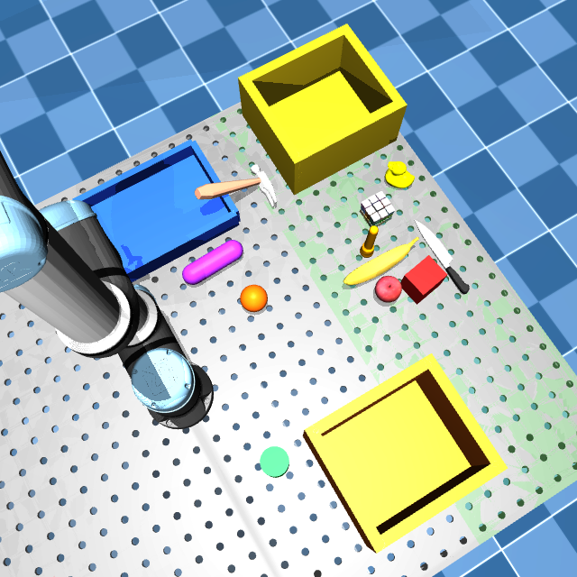
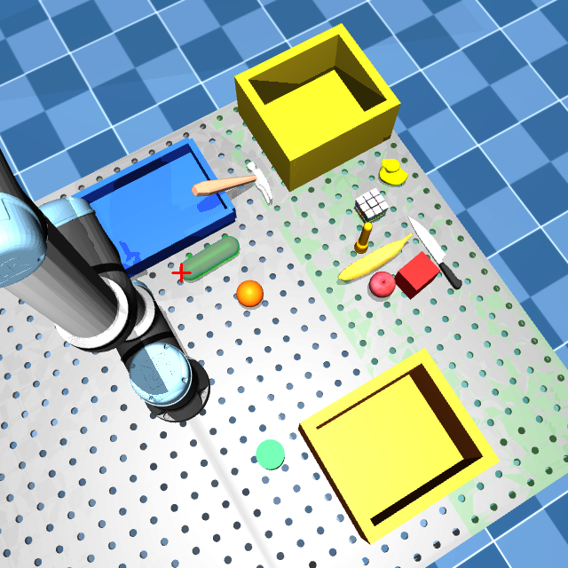
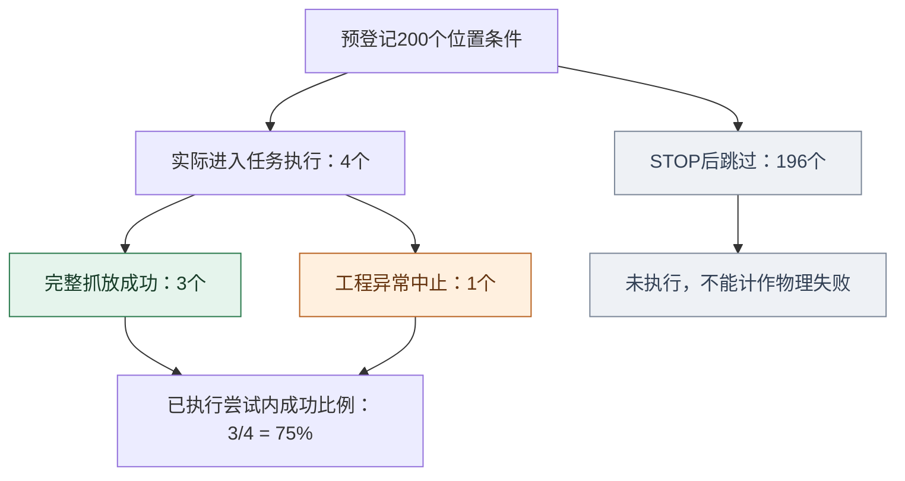

# 当前研究进度：完整抓放已跑通，批量评估在工程异常处暂停

更新日期：2026-11-19（America/Los_Angeles）。本页基于已保存的服务器结果、历史实验图片和代码整理；本次更新没有重新运行实验、调用模型或训练。

**目前已验证完整抓取—搬运—放置—回程能够成功执行，但还没有得到大规模成功率结论。** 单次作业6891成功1/1；后续预登记200个条件的批量作业6892实际执行4次，成功3次、工程异常1次，其余196个条件被停止机制跳过。汇总作业6895已经结束。

## 1. 我们正在解决什么问题，现在到了哪一阶段

项目最终研究的是机械臂执行出错后，能否根据可观察证据和错误反馈，选择合理的修正并真正恢复任务。为此，必须先让感知、动作表示、路径检查、物理执行和任务验收接在同一条可追踪的流程中；“模型给出一个合法动作”与“物体实际放进目标容器”是不同的成果。

当前工作已经推进到**完整物理任务执行与固定动作鲁棒性评估**阶段。此前重点是观察资格、感知结果、抓姿和执行入口；现在已经获得完整抓放成功记录，新的阻塞发生在批量运行的持物路径检查入口。当前还不是模型在线自主反思闭环，也没有证据表明微调带来了本轮成功率提升。

|环节|已有进展|当前边界|
|---|---|---|
|场景与任务|使用978505开发布局，PurpleCapsule → RedBin|本批固定一个布局，没有扩展到随机新布局|
|感知与动作准备|历史图像定位、SAM分割、含噪深度及保存动作已建立|本次复用保存动作，没有新增模型决策|
|完整抓放执行|6891完成抓取、搬运、放置和回程|这是一个固定条件的成功实例|
|位置扰动评估|已发出200条件批量任务并产生全部去向记录|只真正执行了4个条件|
|错误处理|工程异常触发STOP，保留错误与未执行条件|矩阵异常尚未修复，批量没有续跑|

## 2. 实验现场与感知示例



**图1｜实际仿真场景背景。** 图片来自历史作业6731保存的978505初始观察，用于说明机器人、胶囊、容器及背景物件的空间关系。当前完整任务恢复的是该布局已有的原任务初态；本图不是6891成功后的末态截图，也不能凭这张图判断任务成功。目标以实例标识PurpleCapsule和RedBin指定；场景颜色可以变化，RedBin这个名称不表示图中一定是红色箱体。



**图2｜历史感知链中的目标分割示例。** 胶囊区域覆盖了分割掩码，红色标记为对应提示位置。这张图用于解释“从图像中定位并提取目标”这一环节，沿用既有SAM输出，没有在本次图文更新中重新推理。分割看起来正确，也不能替代后续抓取、搬运与物理放置验收。

两张图片都来自已保存的实验文件，没有生成或拼造成功画面。来源与SHA256见[配图说明](../assets/grasp_progress_20261119/README.md)。6891及本批四次运行没有保存可直接展示的成功末态RGB图片，因此本页的成功结论依据运行记录，不使用历史图片冒充成功截图。

## 3. 单次完整抓放具体完成了什么

单次作业**6891**使用最新保存动作，从原完整任务初态开始，依次执行接近、闭合、夹持确认、抬升搬运、释放、稳定等待及回程。Slurm状态为COMPLETED/0:0，用时45秒；同时，任务结果中的success、completed和physical_placement均为true，safety_error为null。


**图3｜6891已经完成的执行流程。** 这是依据阶段记录绘制的流程示意，不是动作录像。物理放置验收同时要求物体位于目标容器的XY/Z范围、有支撑且已稳定；程序正常退出本身不算任务成功。

|6891的关键记录|结果|应如何理解|
|---|---|---|
|完整流程与物理放置|均通过|成功包含释放后的放置及回程，不仅是夹住物体|
|目标箱范围、支撑、稳定|均为true|来自该次运行时仿真评价|
|XY中心残差|约33.86mm|未要求精确落在箱体中心；不能将中心偏差单独等同失败|
|物体倾角|约6.03°|运行记录中的姿态量，不是另一次独立复算|
|初始化步数|500|与实际任务积分单独记账|
|任务步数|8250|原生请求数与返回数一致|
|重试、模型调用、训练|均为0|没有通过多次重试筛选出这次成功|

本次证明的是**这套动作在一个固定条件下可完成任务**。它不证明动作在各种位置上都稳定，也不改变历史静态闭合拒绝或观察资格拒绝的记录；运行时监视器未触发中止，也不等于每个积分时刻均已接受独立接触审计。

## 4. 为什么安排200个条件，实际覆盖了多少

在单次成功之后，本批保持机器人、目标箱、其余场景和保存动作不变，只改变胶囊初始世界坐标XY位置。预登记偏移半径为**1、2、3、5、10mm**，每档40个等角度方向，方向间隔9°，合计200个不同条件。

这样的安排回答一个较小而明确的问题：**同一套动作对目标位置的小幅变化有多敏感？** 它不是200个独立随机布局，也不是让模型在每个新场景里重新观察、规划或反思。此前中心条件6891不重跑，也不并入本批分母。



**图4｜200个条件的最终去向。** 框的面积不表示比例，具体数量以框中文字为准。四次实际尝试的成功比例为75%，而计划条件的执行覆盖只有4/200＝2%；两者衡量的不是同一件事。200项记录全部齐全，表示每个条件都有结果或跳过去向，不表示完成了200次物理任务。

|偏移半径|计划条件|实际尝试|成功|工程异常|跳过|
|---|---:|---:|---:|---:|---:|
|1mm|40|4|3|1|36|
|2mm|40|0|0|0|40|
|3mm|40|0|0|0|40|
|5mm|40|0|0|0|40|
|10mm|40|0|0|0|40|
|合计|200|4|3|1|196|

因此，现在可以报告“1mm档最先执行的四个方向中，三次完整成功”，不能报告“五档大规模测试成功率75%”。更不能删除工程异常和未执行条件，只保留三个成功样本来计算100%。

## 5. 具体在哪一步出了问题

|条件|偏移半径|方向|任务步数|最后记录的阶段|结果|
|---|---:|---:|---:|---|---|
|000|1mm|0°|8250|returned_home|完整成功|
|001|1mm|9°|8250|returned_home|完整成功|
|002|1mm|18°|3250|grasp_confirmed|工程异常|
|003|1mm|27°|8250|returned_home|完整成功|

条件002已经完成接近、闭合和夹持确认。随后，在准备执行持物搬运路径时，几何检查需要把物体姿态构造成SE3变换；该入口调用SpatialMath的SE3.Rt时拒绝了传入的旋转矩阵：

```text
runtime.execute
  → GuardedBackend.run
  → hv_geometry.inspect
  → ot_volume.body_pose
  → spatialmath.SE3.Rt
  → ValueError: expecting SO3 or rotation matrix
```

这里的报错表示姿态构造没有通过库的旋转矩阵检查，**目前只能确定失败入口，不能确定数值根因**。现有堆栈不足以证明是正交性误差、数据读取时点、非有限数值或其他原因；也没有证据把它直接归因于碰撞、滑移或模型选择错误。

由于本批将这类错误归为工程异常，程序写入STOP.json，后续条件标记为skipped_batch_stop。每个条件只有一次尝试，没有自动重试。并行度为2，停止标记不会回滚另一项已经开始的任务；不能把条件003的成功理解成对条件002的失败重试。

## 6. 这次结果说明什么，还不能说明什么

**已经得到的进展：** 完整任务链具备真实成功实例；成功判据已经覆盖放置和回程；批量入口能够区分成功、工程异常和未执行条件，并在异常时保留证据、停止扩展执行。研究关注点因此从“是否已经真正执行完整抓放”推进到了“为什么在相邻扰动条件下出现工程异常，以及修复后能覆盖多少条件”。

**仍未完成的部分：** 五档位置扰动扫描只覆盖了2%的计划条件；矩阵异常尚未修复；没有未见布局评估，也没有模型在线反思或微调收益对照。单次6891的1/1与批量3/4各有不同的登记范围，本页分别呈现，不合并为统一性能指标。

本轮新增模型调用、训练和独立事后审计均为0。此前静态闭合检查拒绝、视觉资格拒绝和历史失败记录保持原样，不能因为出现动态成功就把它们改写为通过。

## 7. 接下来应做什么

下一步应围绕已经保存的失败002收敛问题，而不是重新启动一整批重复试验。

1. **先查清失败姿态数据。** 从保存状态及对应读取路径检查有限值、旋转矩阵正交性和行列式，并明确取值时点。先区分数据本身异常、数值容差问题或状态读取时序问题，形成能由证据支持的解释。
2. **针对确认的根因修复。** 在独立新版本做局部修正，保持原碰撞、掉落、释放及任务成功判据；不能通过直接绕过矩阵检查来掩盖异常。
3. **再登记剩余条件的续跑。** 明确哪些是旧未执行的196个条件，哪些属于另行授权的修复验证；已完成条件、旧失败和原claim保留。续跑结果按五档偏移分别报告覆盖、成功和错误类型。

这三项是后续建议，**本次图文更新没有执行诊断、修复或续跑**。完成固定动作的扰动评估后，才有依据进一步讨论跨布局能力和在线反思效果。

## 8. 代码、报告与材料范围

- [本批结果摘要](GRASP_BATCH_20261119.md)：单独保存批量分母、条件去向和错误入口。
- [单次完整抓放报告](../research_workspace/qualified_full_task_trial_v1/REPORT.md) / [批量报告](../research_workspace/qualified_grasp_batch_v1/REPORT.md)。
- [批量执行入口](../research_workspace/qualified_grasp_batch_v1/worker.py) / [自动汇总入口](../research_workspace/qualified_grasp_batch_v1/summarize.py)。
- [完整抓放运行器](../server_source/qualified_execution_v1/runtime.py) / [持物位姿构造](../server_source/oriented_transfer_v1/ot_volume.py)。
- [代码与文档目录](CODE_AND_DATA.md) / [本页配图来源](../assets/grasp_progress_20261119/README.md) / [11月11日历史进展](CURRENT_PROGRESS_20261111.md)。

按照当前发布范围，仓库以代码、配置和文档为主，本页另附两张有来源的精选报告配图。没有恢复大文件Release上传；完整原始图像、轨迹、日志、状态和训练产物仍保留在原实验环境。历史报告里部分数据链接依赖原实验目录，不能把代码发布等同于全部原始材料已经公开。
