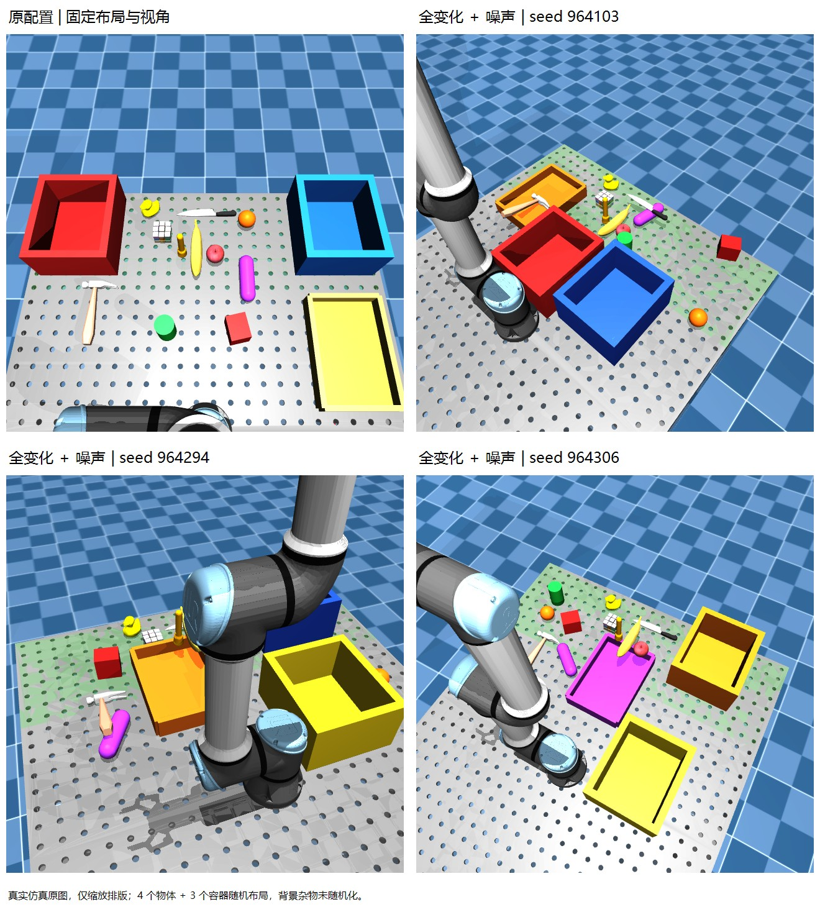
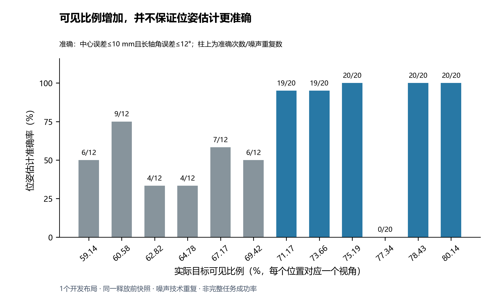
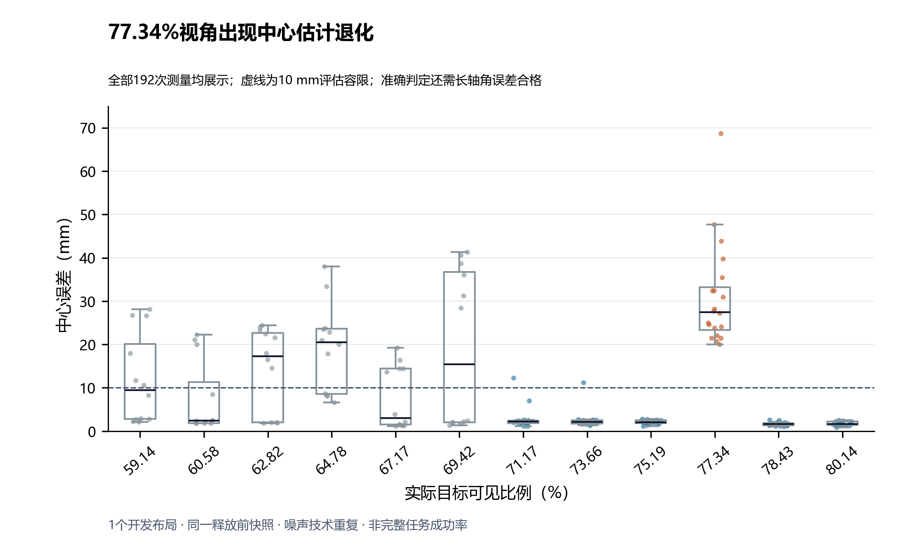
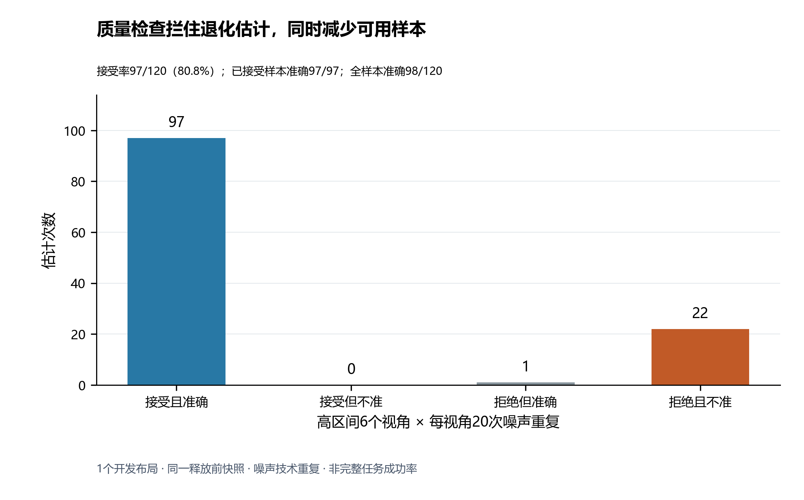

# 最新进展：从随机场景的放置失败，推进到可见性与持物位姿标定

证据截点：2026-11-11，作业6497结束；本页为最新研究状态。11月4日数据采集与视觉微调报告保存在[历史图文进度](CURRENT_PROGRESS_20261104.md)，其17/31步为当时截点，本轮未核验该训练的最终结果。

**当前已打通一次表面抓取—搬运—释放执行，定位到持物相对位姿变化和观察门禁问题，并完成三轮离线可见性标定。找到若干低于85%的准确观察方向，但没有找到可单独保证高任务成功率的可见比例临界点。** 正式比例门槛未修改，本轮标定未做物理任务、模型调用或训练，也未证明任务成功率提升。

## 1. 用真实随机场景截图说明研究问题

这张历史拼图来自11月4日归档：左上为原配置，其余为三个不同种子的增强场景，未合成或移动物品。仅有 **baseline、varied_noisy** 两种正式场景，没有新增中间档。增强场景启用7个指定实例（4个几何物体+3个容器）的位置变化、容器配色、相机位置/朝向/视场角变化，以及3 mm深度噪声、2%缺失。7个背景实例仍固定，不能写成14件物品全随机。RGB截图本身不能证明深度噪声。

随机布局初始提案覆盖X=0.85–1.55 m、Y=0.08–1.10 m，并接受边界、间距、碰撞与任务可行性筛选。相机方位偏移±60°、仰角35°–75°、距离0.8–1.3倍、视场角48°–65°；筛选后不保证均匀覆盖。[原图、来源和实现范围](CURRENT_PROGRESS_20261104.md)

早期同批48条件中，原配置成功24/24，增强场景成功5/24（14进入执行、10可见性拒绝）。这是当时执行链的物理成绩，无语言模型调用；不能与后续不同工程版本的开发记录混成一条提升曲线。

## 2. 最近实际推进了什么

| 阶段 | 实际实现 / 运行证据 | 结论与限制 |
|---|---|---|
| 模型抓姿接口（6481） | 真实模型给出两次合法抓取意图，第二次收到plan_rejected后改抓点 | 两次都被安全规划拒绝；0次物理执行，不能算模型提升 |
| 表面抓姿（6484） | 找到安全抓取端点与静态路径 | 证明存在可执行候选，不等于成功放置 |
| 单次物理执行（6486） | 抓起、搬运、释放、归位完成 | 物体最终箱外；作业FAILED/1:0，不是成功任务 |
| 独立审计修订（6488） | 修正审计配置上下文后，只读复算原记录一致；未重跑动作 | audit passed=true、task_success=false；累计跨迭代开发账本仍3/8 |
| 持物观察（6492/6494） | 一次只采集物理运行停在释放前；两阶段各32个候选、0个全帧合格；只读诊断复现拒绝 | 采集不计为完整任务尝试；旧在线观察入口的严格无扰动审计仍未通过 |
| 离线标定（6495–6497） | 独立快照渲染、三轮视角/噪声标定、代表拟合独立复算 | 排除了“只要降低比例即可解决”的简单解释；尚未部署新控制规则 |

**放置失败的关键证据：** 搬运227/227个采样都有双侧指垫接触，但物体相对夹爪中心变化64.96 mm，释放前相对静态预测偏差63.33 mm；TCP水平误差只有2.75 mm，最终物体相对箱中心水平偏差81.34 mm。因此“夹爪到位”不能保证“物体到位”。现有证据不能唯一判断滑移、滚动或接触重排各自的贡献。

这些位姿量来自独立仿真审计，只用于评价，不能把私有真值或人工预填原因送给模型。后续仍由模型根据许可视觉、深度、机器人状态与标准反馈判断，执行器负责安全边界。

## 3. 85%是不是临界点：最新三轮标定

用户将原85%改为待检验假设。本轮在**1个独立开发布局（964347胶囊）**的初态、抬升后、释放前3个快照开展诊断。几何胶囊拟合器使用模拟辅助分割；这不是语言模型准确率实验。

| 作业 | 实际内容 | 单视角估计 | 双视角估计 | 调度终态 |
|---|---|---:|---:|---|
| 6495 | 三阶段原32相机，51视角通过标定，各3组噪声 | 153 | 132 | COMPLETED/0:0，73秒 |
| 6496 | 释放前过渡区间补6角度，各12组新噪声 | 72 | 0 | COMPLETED/0:0，28秒 |
| 6497 | 释放前高区间6角度，各20组新噪声 | 120 | 0 | COMPLETED/0:0，40秒 |
| 合计 | 108候选检查，63个通过标定的视角记录 | **345** | **132** | 物理任务/模型调用/训练均0 |

视角、阶段和噪声重复都不是独立任务样本。下面三张新图取6496/6497的同一释放前快照，共192次技术重复；完整计数与源身份见[证据索引](EVIDENCE_INDEX.md)。

### 可见得更多，不一定估计得更准

准确要求**中心误差≤10 mm且长轴角误差≤12°**。横轴每一项是实际采样视角，间距仅用于排列，不是均匀可见比例扫描；灰色每视角12次、蓝色每视角20次新噪声。没有根据这些点插值一个临界值。

| 可见比例 | 准确次数 | 质量接受次数 | 中位中心误差 |
|---|---:|---:|---:|
| 71.17% | 19/20 | 18/20 | 2.20 mm |
| 73.66% | 19/20 | 19/20 | 2.10 mm |
| 75.19% | 20/20 | 20/20 | 2.04 mm |
| **77.34%** | **0/20** | **0/20** | **27.46 mm** |
| 78.43% | 20/20 | 20/20 | 1.63 mm |
| 80.14% | 20/20 | 20/20 | 1.62 mm |

75.19%、78.43%、80.14%是值得继续验证的具体方向，**不能推广成“所有≥75%视角可靠”**。77.34%是反例；59.14%–69.42%的低区间也不单调。[全部12行汇总](../evidence/visibility_6495_6497/summary.csv)

### 退化发生在中心估计，不能只看拟合残差

每个点对应一次测量；箱体为四分位区间，中线为中位数，须为1.5 IQR，全部异常点保留；水平抖动只为避免重叠。虚线10 mm是诊断容限，尚非物理任务成功界限。

77.34%视角最大中心误差68.71 mm，拟合残差仍小，但条件数达4.35×10⁷–5.01×10⁷，相邻准确视角约57–62。说明残差小并不保证参数可辨识。形状遮挡、采样和求解器因素尚未唯一分解，不能直接归因为某一种原因。

### 质量检查有价值，但必须同时报告覆盖率

高区间120次估计中，98次准确；质量检查接受97次，97次都准确，拒绝23次（其中1次其实准确）。因此同时报告**接受率97/120=80.8%**和**接受后准确97/97**。不能删掉拒绝样本后宣称整体100%，更不能称为任务成功率100%。这些统计尚未在独立布局复现。

初态可见≥60%时29/30估计准确；抬升后40.31%、44.46%、52.37%三个方向各3/3准确。不同阶段不能混为一条通用曲线。并且即使把比例门槛降到10%，持物阶段仍无全14物体合格画面，其他物体像素不足、连通性等条件仍阻断；持物双视角质量接受也仍为0。

## 4. 目前做到哪一步，哪些还没完成

**已经验证：** 三个标定作业完成；8项新增本地测试、15项远端测试通过；独立进程对45个代表性拟合复算一致；122份同步文件及21份源码身份核验。发布时另外从原测量重算192行分类、12行准确数/接受数/中位数/最大值，并核对45项审计。源脚本、统计CSV、哈希来源和图像QA均在仓库中。

**没有完成：** 通用高任务成功率临界值、新规则部署、旧在线观察入口修复、独立布局复现、完整任务性能提升，以及本轮新模型训练。11月4日训练启动是历史事实，本次不能补写未经核验的最终成绩。

## 5. 下一步怎样提高完整任务成功率

1. 对照75.19%/77.34%/78.43%点云，查清关键形状覆盖与拟合退化；保持条件数和碰撞等安全检查。
2. 在独立快照环境比较“比例筛查+位姿可辨识性/质量检查”，同时量化整帧其他门禁的误拒绝；保留随机布局、随机相机和原强度噪声。
3. 增加独立布局和对象，冻结候选规则后再接入持物观察—有界调整—释放闭环。禁止把本例65 mm私有偏差硬编码成补偿。
4. 用独立完整任务对照检验：同时报告含拒绝分母的完成率、接受率、失败原因、模型与规则同预算比较。暂定目标为至少40个独立留出条件、成功率点估计≥90%且95% Wilson下界≥80%；这是待验证目标。
5. 先确认执行链和观测可用，再判断是否需要新增微调数据与训练。本轮发布仅整理已有证据，不启动新仿真或训练。

## 组会可以这样讲

“我们先把固定场景扩展成随机位置、随机视角和有噪声的场景，暴露出抓取和放置链路的问题。最近已经找到能抓起并搬运的抓姿，但一次放置仍失败：夹爪到位时，物体相对夹爪已经变化约65毫米。所以开始研究持物观察与位姿重估。三轮标定发现，75%左右的一些视角估计很好，但77.34%的相邻视角反而全部失败，说明不能只调一个可见比例。下一步要结合形状可辨识性与拟合质量，再用独立完整任务证明成功率提升。”
