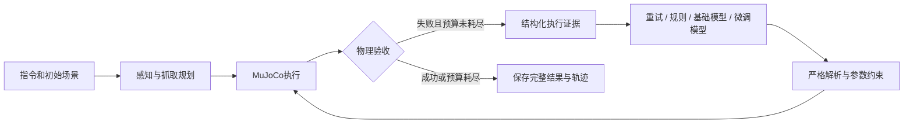

# 论文实验详细计划

版本：2026-10-21，作者题目补充版；状态：拟执行方案，包含已完成开发证据。论文题目为**《基于机械臂的错误反馈于智能反思系统》**，按作者原文保留。题目并不自动构成真实机械臂或多模态实验已完成的证据；当前已验证范围仍为仿真反馈与文本反思。

## 1. 研究定位与可检验问题

当前可落地的主线是：机械臂执行失败后，系统把可观测错误、执行阶段、位置残差和当前参数组织成证据，由反思模型输出受约束的参数修正，再交给同一控制器执行并验证结果。

围绕题目，研究对象是完整的错误反馈与反思系统，不能将论文缩减为一次模型微调。QLoRA服务于反思模块；错误反馈是否充分、反思是否产生有效动作、闭环是否真正恢复任务，需分别评价。

| 题目要素 | 系统职责 | 当前基础 | 对应验证 |
|---|---|---|---|
| 机械臂 | 执行抓取、搬运与放置，输出可核验轨迹 | MuJoCo物理仿真 | E0可执行性，E1完整任务成功率 |
| 错误反馈 | 描述失败阶段、观测残差、接触与验收结果 | 已有结构化证据，非所有故障都覆盖 | E4证据消融，反馈完整性与误报检查 |
| 智能反思 | 利用反馈选择合法且有用的修正 | 规则、基础模型、微调模型 | E1四组比较，E2/E3训练变量，E5泛化 |
| 系统闭环 | 约束输出、执行修正、重新验收、管理预算 | 6场景24次开发执行及审计 | 完整失败分母、执行一致性、成本与异常恢复 |

“智能反思”的操作性定义是：依据实际执行反馈生成下一次可执行的修正，并接受外部物理验收。输出一段解释、JSON合法或cause文本流畅都不足以证明反思有效；当前不主张模型具有可验证的内在因果推理能力。

要回答的主要问题是：在相同初始条件、相同感知与抓取模块、最多三次尝试的条件下，微调后的模型是否比直接重试和未微调模型提高持续故障恢复率？收益是否能延伸到未用于训练的任务组合与扰动条件？

| 问题 | 实验对应 | 支持该问题需要的证据 | 可能的否定结果 |
|---|---|---|---|
| RQ1：微调是否改善闭环恢复？ | E1 四组对照 | 独立任务上的配对成功率差与不确定性 | 收益只出现在6个开发场景 |
| RQ2：训练量与轮次哪个更有效？ | E2 学习曲线、E3 轮次 | 同一验证集合、受控预算的趋势 | 更多数据仍只是模板复现 |
| RQ3：结构化执行证据是否必要？ | E4 输入消融 | 单变量改动后的配对结果 | 仅错误文本已经同样有效 |
| RQ4：能否超出已见任务分布？ | E5 泛化 | 新任务族、扰动档位、对象分别评估 | 同族成功但新对象失败 |
| RQ5：模型相对规则有什么价值？ | E1、E5、E6 | 规则失效条件下的恢复、成本或适应性证据 | 规则持平且更便宜，则保留规则方案 |

当前贡献候选是可追溯的反馈—修正—执行—验证流程、严格区分监督来源的数据构建方法、以及受控的闭环评估。创新性需结合文献与实验确认；不能将“用了QLoRA”本身作为独立创新结论。

## 2. 系统与控制变量

主实验固定感知、分割、几何候选、碰撞阈值、控制器、物理步长、线程配置、故障注入版本与验收函数。不同方法只能改变“失败后的修正决策”。随机数种子、物体初始位姿、容器位姿和故障强度写入冻结清单并核对实际状态。

文本模型仅接收部署时可得到的证据，不输入隐藏故障注入标签、未来成功标签、规则答案、测试划分或私有图片路径。`cause`文本继承错误信息的现有标签不能被当成经过独立标注的推理链。

当前使用仿真感知，不把仿真真值位置下的恢复率解释为视觉识别能力。完整VLM/SAM链路需作为后续独立层次评估。

## 3. 数据集设计与质量门禁

### 3.1 三个不同的集合

1. **完整任务集合**：所有预定场景，包括首次成功、持续失败、无候选、无效输出和运行异常。闭环任务成功率以此为分母。
2. **监督修正集合**：从完整轨迹中筛选的有效修正；用于训练或标签匹配。当前还要求同预算重试失败、修正后紧邻一次物理成功。
3. **封存评估集合**：开发过程中不查看结果、不用于提示调优或模型选择；最终报告完整任务指标，而不是仅对成功修正样本评价。

任务数不等于监督条数；模型调用次数不等于场景数；同一场景三次尝试不能当三条独立实验。

### 3.2 来源与导出要求

当前批次只使用 `rule_expert / model=null`，保留规则版本与源码哈希。未来如加入纯模型、人工或混合监督，另建版本记录来源、模型、提示词与标注方式，分别报告数量和结果。

每条监督必须能追溯：原始任务 → 失败证据 → 原始修正 → 参数合法性 → 下一次真实执行参数 → 紧邻物理验收 → 同预算重试对照。越界、未知字段、未实际生效和仅文本宣称成功的记录不得导出。首次就成功的任务无反思监督，但保留在评估分母。

### 3.3 划分与防泄漏

- 当前pilot快照163/48/38保持不变。扩量产生的新计数不能追写到pilot版本。
- 新实验按物体—容器—布局族分组；同一轨迹、重试、近重复输入、同一布局的小扰动都归同组。
- “同任务族新种子”用于同分布验证；“未见任务族”单独用于泛化。不能混为同一种独立性。
- 已用于开发的seed40000六场景，以及历史已查看结果的场景，只能继续作为开发记录，不能改名为最终测试。
- 验证与测试的监督条数达到100，并不等于已有100个未筛选闭环测试任务；须另外冻结完整评估场景清单。
- 清单冻结前检查历史任务、提示示例、训练输入与标签去重；同文本去重之外还检查任务族、布局来源和归一化残差的近重复。
- OOD新物体与新扰动档位在训练中排除；无法从现有采集中留出时，另开批次，不重分已有测试样本。

### 3.4 下一轮训练启动条件

去重后train≥1000、validation≥100、test≥100；训练中calibration/collision/placement各≥100；另通过来源、执行一致性、跨集隔离和物理证据审计。数量门槛仅为当前工程约定，不保证论文结论充分。

采集在途时只读检查，不运行会重建status或dataset的全量审计。到门槛后通过既有正常停止机制收尾，再冻结数据与审计。当前正在运行的代码身份不得修改。

## 4. 故障与场景覆盖

| 类型 | 主实验角色 | 必须记录 | 关键限制 |
|---|---|---|---|
| calibration | 持续校准偏差 | 偏差向量、实际残差、修正后抓取 | 参数方向与坐标系一致 |
| collision | 持续碰撞 | 运动段、接触对象、抬升高度与可达性 | 无候选不能归为参数恢复失败 |
| placement | 持续放置偏差 | 容器边界、释放位置、最终验收 | 回零动作错误与放置失败分开 |
| none | 无故障对照 | 首次成功率、误干预率 | 检查方法是否破坏本来成功任务 |
| planning/grounding | 后续单独协议 | 注入何时发生、是否持续 | 历史故障重试会自然消失，不能直接证明反思收益 |

先用开发场景验证故障确实被触发以及无故障时任务可执行。正式评估阶段遇到“注入但未实际触发”仍保留全量结果，并另报实际触发率；按预先统一首轮得到的失败子集统计恢复，不能按各方法结果事后选择子集。

## 5. 实验矩阵

下表数量均为**拟议预算**，不是已完成结果，也不是统计功效保证。实际对象和任务族先做可执行性与历史使用检查，再冻结配置。

| 编号 | 实验 | 建议起始规模 | 方法/变量 | 产出 |
|---|---|---|---|---|
| E0 | 运行与故障前置验收 | 开发集各故障至少5例，另含无故障 | 固定仿真、故障与首轮 | 可执行性、实际触发率、初始配对 |
| E1-dev | 主比较开发评估 | 30个场景实例，三故障各10 | retry/rule/base/SFT | 修通新执行与汇总版本，不用于最终结论 |
| E1-final | 封存主比较 | 起始120场景：三故障各30、无故障30 | 同四组，480次完整执行 | 完整成功率、配对差、恢复率、成本 |
| E2 | 数据量学习曲线 | 163、300、600、1000条；数据充足再2000 | 统一分层嵌套子集、1 epoch | 样本量与泛化、训练成本关系 |
| E3 | 轮次与训练随机性 | 1000条固定数据，1/2/3 epoch | 优先seed42；候选配置再42/43/44 | 过拟合诊断、配置稳定性 |
| E4 | 输入证据消融 | 与开发闭环集合配对 | 错误文本/加阶段/加几何残差 | 哪类证据影响实际恢复 |
| E5 | 分层泛化 | 起始每轴30例，三故障分层 | 新组合、新扰动、新物体分别报告 | 同族到跨族的性能变化 |
| E6 | 视觉或混合监督扩展 | 通过接入验收后先12～24例 | 每次只改变一个因素 | 判断是否值得扩大 |

E1-final尽量覆盖至少10个不同布局/任务族并在各故障分层平衡，具体数量依实际可执行任务族调整。如果仍只有两个物体容器组合，应明确任务族不足，不用增加随机种子掩盖覆盖局限。

优先次序：E0 → E1-dev → E2/E3选择配置 → E4开发消融 → E1-final与E5封存评估。最终测试之前写明主比较、候选配置、停止规则和统计方法，避免反复看测试再调参。

### 5.1 四组主对照

- retry：固定参数直接重试，最多三次。
- rule：现有RuleReflector，规则版本冻结，禁止按测试结果补规则。
- base：冻结Qwen3.5-4B、不载adapter。
- SFT：相同基础权重与量化方式、提示、解码参数，仅载入指定adapter。

base与SFT保持非思考、greedy、256输出token作为首版配置。不给SFT额外规则回退、JSON修复或更多调用机会。无效输出按现行预先冻结策略终止或计失败；改变容错策略必须四组协议重新声明，并视为新实验因素。

### 5.2 数据量与轮次不能混淆

E2固定1 epoch时数据量越大，更新步数也越多，因此只能说明“更多数据及其对应训练预算”的整体效果。若要声称数据多样性独立有效，追加等更新步数或等训练token预算对照，并明确小集合重复率。

优先从相同基础模型重新训练各数据规模，不连续在同一adapter上叠加数据后把结果当独立学习曲线。每个规模保持任务族/故障覆盖尽可能一致；163条原pilot单列为历史点，正式嵌套曲线重新构造受控的163条子集。

E3保存每epoch checkpoint，依据验证闭环成功率优先选择，其次看无效输出、耗时，再看验证loss；成绩相同优先较早checkpoint。验证loss继续下降但闭环无改善时，不默认增加轮次。

### 5.3 证据消融与泛化

E4各输入版本独立训练同配置模型，避免只在推理时删字段造成分布偏移后将其误判为证据贡献。推理删字段可作为额外鲁棒性测试，单独命名。

为对应题目中的“错误反馈”，E4补充反馈审计：依据执行日志人工复核少量分层开发案例，记录阶段定位是否正确、必需字段缺失率、单位与坐标系是否一致；隐藏故障标签仅用于离线审计，不进入模型输入。若采用人工阶段标签，先定义标准并保留原日志，不能把注入类型直接等同于实际错误类型。

反馈鲁棒性作为次级实验：在独立开发副本中分别遮蔽一个关键字段、加入预设幅度的测量噪声，观察无效修正、危险参数拒绝与任务成功率变化。先固定噪声范围和安全约束，不修改原始证据；这衡量反馈扰动下的鲁棒性，不单独用于证明某字段的训练贡献。无故障组另检查误报与误干预。

E5分开测试：已见对象的新组合、新位置/偏差幅度、未见对象/形状。现有OrangeSphere/PurpleCapsule上游无候选问题需先在开发对象或开发布局定位；不能在测试场景调几何参数。若改候选模块，先单独比较候选模块，再在固定候选版本上比较反思模型。

## 6. 评价指标与统计

主指标：完整任务成功率＝预算内物理验收成功任务数/全部预注册任务数。主比较：SFT−base的配对成功率差；retry和rule为关键参照。

辅助指标包括：

- 首轮失败条件恢复率；子集由公共首轮或核对一致的首轮状态定义。
- 首次成功率、故障实际触发率、无候选率、无效输出率、服务错误率。
- 平均与中位尝试次数、模型调用数、端到端耗时P50/P95、显存与训练成本。
- 按故障、任务族和OOD轴分层的成功/失败计数。
- 监督任务上的JSON合法率、参数匹配率与token交叉熵，仅作辅助诊断。

平均尝试次数必须包含失败任务；非法输出提前结束可能使平均次数变低，不能据此声称效率更高。成功任务耗时可以另列，但不能替代全量成本。

对同一组场景进行配对统计，报告效应量和95%区间。单方法成功率可给Wilson区间作为描述；考虑同族种子相关性，主要差值区间按任务/布局族做cluster bootstrap。任务族过少时报告限制，不把重试或种子当独立重复。满足独立配对条件时可补精确McNemar检验，不能直接对相关样本套用。

正式样本量在开发结果基础上估计不一致配对比例及族内相关性，以预设最小有意义改进（建议先讨论10个百分点）进行功效或精度分析。120场景只是起始资源预算。三次训练seed的评估结果也有共享测试场景相关性，应分别报告及汇总波动，不简单将样本量乘三。

若报告多个次要比较，提前约定Holm校正或明确为探索性分析；不要用最有利的故障子集替代主结果。

## 7. 运行失败、恢复与可复现性

冻结每次实验的配置、源码/数据/模型hash、提示词、依赖、种子、数值线程、设备映射、Slurm作业号。保存原始请求、修正、实际参数和逐次轨迹。

下一轮建立新冻结执行版本并整合已验证的安全汇总：首次成功、零模型调用时允许没有请求日志；实际发生调用但日志缺失必须标异常。先跑首轮成功/零调用、合法修正、非法输出、服务失败四类端到端验收。

基础设施中断与模型失败分开记录。运行异常不静默剔除；保留全量可交付成功率，若另做算法指标须同时披露排除数量、预定规则和重跑映射。仅重跑事先定义的基础设施故障，保留原结果，不挑最好一次。

所有样本导出与结果汇总均需检查完整性；历史3717的FAILED状态及后处理恢复记录永久保留。仓库的精选证据不能替代原服务器完整轨迹归档。

## 8. 实验验收与结论分支

- 流程验收：真实参数更新、保存重载、独立生成、真实仿真闭环与日志一致。
- 数据验收：来源可追溯、无跨集泄漏、有效修正与物理证据对应。
- 主结果验收：冻结任务完整执行、四组预算一致、全部失败入分母、区间与分层结果可复算。
- 若SFT优于base但不优于rule：结论定位为规则知识蒸馏及其适用边界，进一步比较成本和新条件适应性。
- 若只在同族有效：论文如实限定场景，优先增加任务族与观测多样性。
- 若数据扩大仍无改善：先检查标签模板、证据缺失和几何瓶颈，再决定更强模型或新监督；不无限加epoch。
- 若真实视觉链路尚未验证：标题和摘要中的视觉/真实机器人主张必须保持为计划或限定内容。
