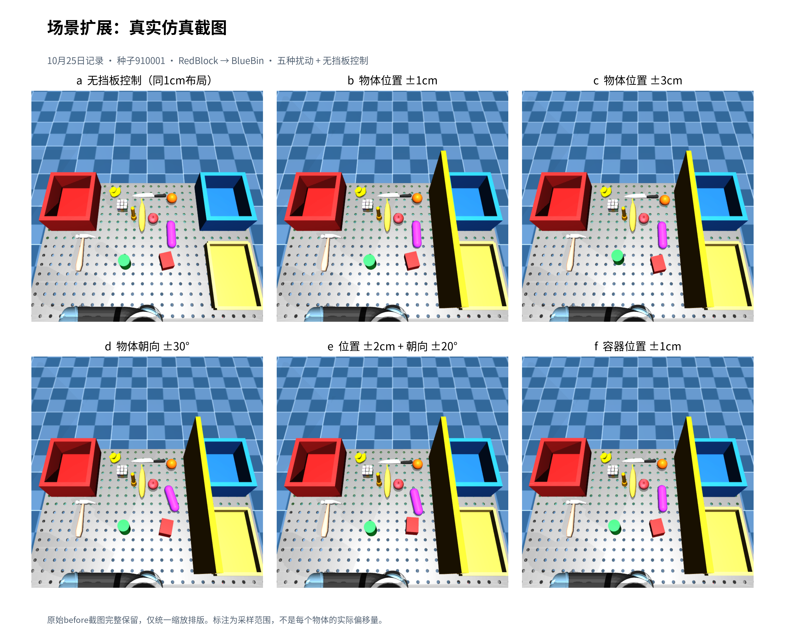
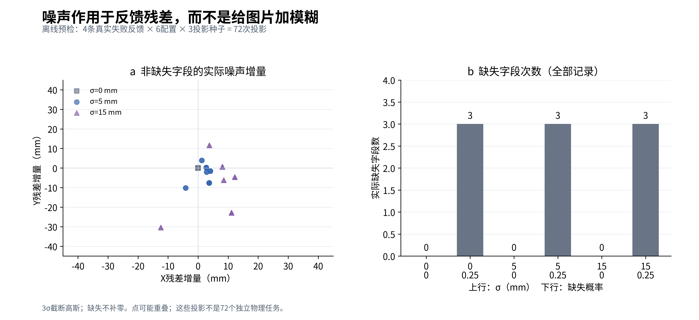
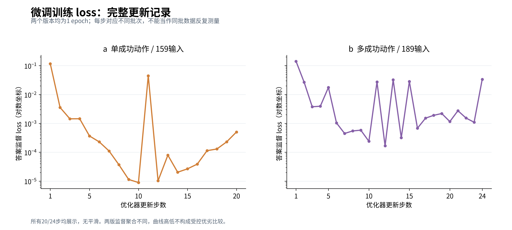
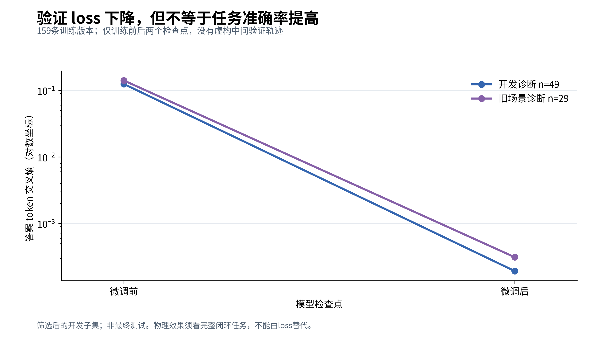
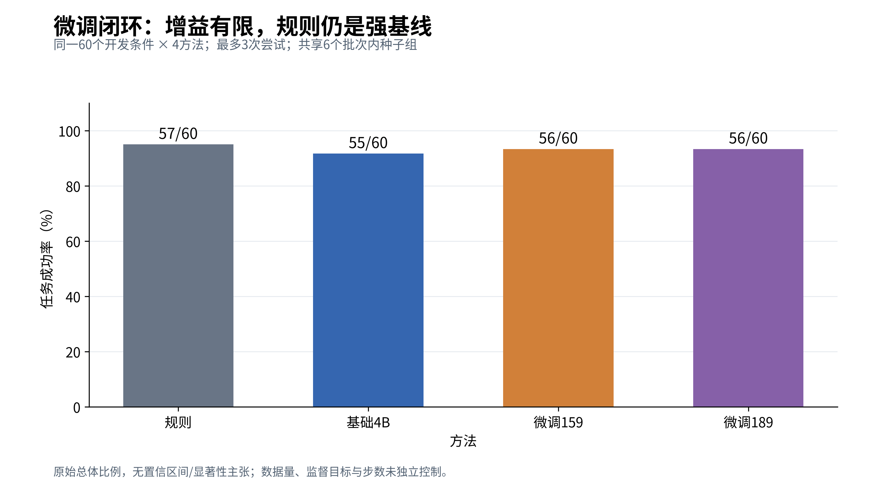
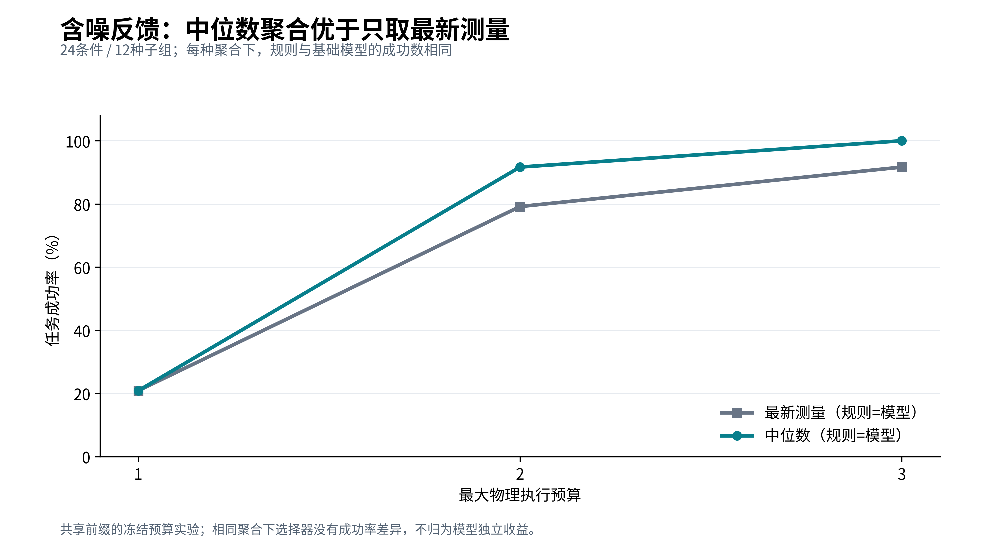
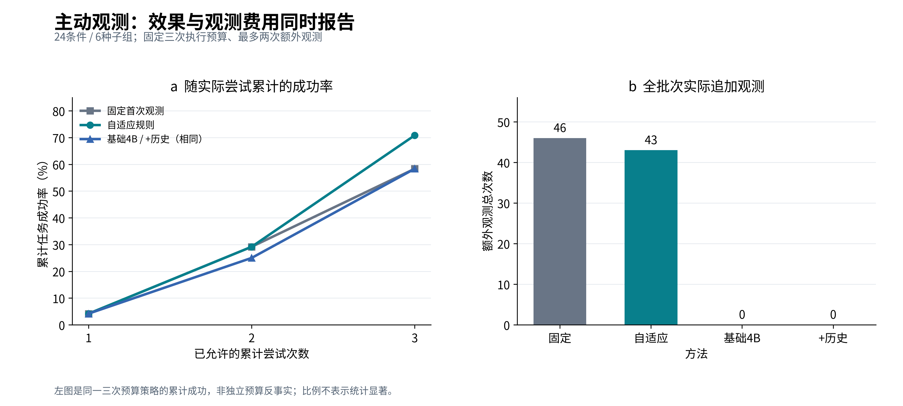
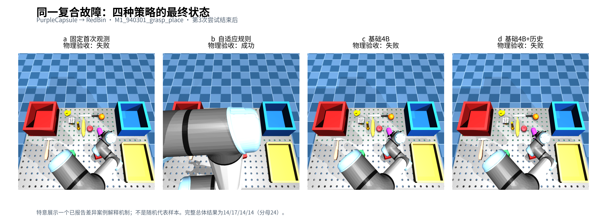
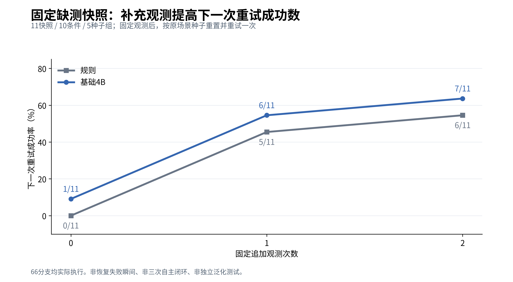

# 组会讲述提纲

更新：2026-10-28。论文题目：《基于机械臂的错误反馈于智能反思系统》。

## 可以直接讲的开场

我的目标是让机械臂在失败后利用错误反馈决定下一步修正，并通过物理执行检验效果。现在已经完成仿真执行、结构化反馈、受限动作选择、数据审计、学生模型微调和闭环评估。

训练方面做了早期163条参数修正pilot、159条候选选择微调和189输入多成功动作监督。后续60条件对照中，基础模型成功55个，两个微调模型都成功56个，规则成功57个。因此训练流程已跑通，但不能把标签拟合或loss下降解释为显著任务增益。

后续我将问题转向含噪、缺测反馈下的观测决策。最新24条件四组对照里，自适应观测规则成功17个，固定观测、基础模型和加历史模型均为14个。自适应规则保留观测预算用于后续失败，模型却从未选择追加观测。

现在针对性诊断也已完成并通过最终审计。402次模型请求显示：补全候选条目没有触发观测，明确指令后则全部选择观测。11个缺测快照的66个物理分支中，固定补看0/1/2次，规则下一步成功为0/5/6，基础模型为1/6/7。说明补充信息在这批条件有价值，但还要验证模型能否在独立条件下自主选择正确时机。

## 建议展示顺序

1. 框架：反馈 → 观测/修正选择 → 严格执行 → 物理验收。
2. 工程：来源可追溯、同条件对照、无规则兜底、冻结与审计。
3. 微调：展示完整60条件表，说明增益有限与强规则基线。
4. 机制：观测聚合和主动观测对照，成功率与费用一起展示。
5. 当前诊断：为什么模型没有主动观察，哪些阶段已审计。
6. 后续：根据诊断构造学习目标，再做独立评估，最后考虑真实视觉与真机。

## 可直接展示的图片

### 场景与噪声

目前是局部扰动：物体位置/朝向变化，容器仅±1 cm微扰，整体布局仍基本固定。三个容器随机重新摆放已列为后续任务，尚未执行。

反馈层另加数值噪声及字段缺失，RGB截图没有人为模糊；下图为全部72条离线投影记录。

### 微调与实际任务表现

训练图分别包含159条版本的20次更新和189输入版本的24次更新，未平滑；两版目标不同，不按曲线高低直接排名。

验证图只有159条版本的训练前/后两个检查点，不是逐步验证曲线。

物理闭环中，规则57/60、基础模型55/60、两版微调均56/60，不能用loss下降替代实际成功率。

### 观测机制与诊断

相同聚合方式下，规则与模型结果一致。下图支持信息处理的价值，不支持模型独立优势。

自适应规则最终17/24，其余14/24；左图为同一三次尝试策略的累计成功，右图为实际额外观测费用。

下图为已知差异案例M1_940301_grasp_place，特意选来解释行为，不是随机代表样本。成功标注来自日志，物体可能被机械臂遮挡。

固定11个缺测快照补看后再重置重试一次，合计66分支。下图支持本批信息增量价值，不代表模型已经学会自主观测。

## 常见追问

**不微调也能完成任务，论文还有什么研究价值？**

研究对象是失败反馈与恢复系统。反馈组织、观测聚合、预算分配及执行验证都有可独立检验的设计问题。微调已经做过实证比较，其有限收益也是研究发现；是否继续训练取决于是否找到可学习的决策缺口。

**12.5个百分点的提升是不是模型带来的？**

目前不是。17/24来自自适应规则，模型方案为14/24。这个差异支持观测分配设计的后续研究，但小规模相关开发条件尚不能证明统计显著或真机泛化。

**模型遵循明确指令选择观察，是否已经解决问题？**

还没有。选择观察只是决策行为，需要核验其是否在必要时触发、是否改善物理结果、是否增加不必要成本。明确指令属于专家策略注入，应单独报告。

**为什么不能把45次规则一致选择都拿来训练？**

其中只有36次下一步物理成功。选择一致不等于成功标签；还要保留实际后果及数据来源。

**当前最大的局限是什么？**

合成传感器噪声、理想错误标签、少量种子组、开发集迭代，以及尚未完成的真实视觉与真机验证。最终盲测也没有用于本轮开发。

具体状态、时间点与数字见[当前进度](CURRENT_PROGRESS.md)；汇报时不要把快照当成实时状态。
