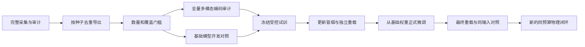

# 当前自然失败数据与微调准入协议

状态截点及数值以[组会报告](MEETING_20261104.md)和[当前进度](CURRENT_PROGRESS.md)为准。此页说明当前协议，不追写历史实验结果。

## 场景、任务和输入边界

正式场景只有 `baseline`、`varied_noisy`。增强场景包含物体/容器大范围布局、容器颜色、相机位姿和视场角变化，深度高斯噪声σ=3 mm、缺失概率2%。自然失败采集不使用人工故障注入。

任务覆盖 RedBlock 和 PurpleCapsule。训练、开发按布局种子分区；最终盲测不参与采样筛选或调参。相机可见性、几何可行性、执行和审计分别留账，不能只报告通过筛选后的成功而隐藏筛选分母。

AI只接收公开观测与执行事实；私有几何、接触真值和未来分支结果只用于资格/审计与离线评估。允许动作的语义和合法范围可以公开，不能预填某一状态的正确根因或正确动作。

## 采集与计数

同一条件共享首尝试；失败后按冻结的三条探索分支验证顶面抓取、向下30 mm、3倍执行时间及组合，最多7次唯一尝试。分支探索不是AI自主执行效果。

- 共享首帧和重复状态去重；自然失败快照、SFT条目、布局组、尝试数、实际运动次数分别报告。
- 恢复监督必须对应实际合法动作、参数生效及后续成功。可称“已验证有效”，不能称“唯一最优”。
- 规划拒绝、工程异常及 `object_outside_container` 单列，不计入自然失败准入数。
- 机器人自接触或可识别的动态几何重建超限，整条件保留并排除监督；未知异常中止。
- 已消费轨迹不自动重跑；未启动条件才能续接。冻结源和失败日志保持原样。

## 不可临时降低的准入门槛

| 类别 | 要求 |
|---|---|
| train 自然快照 | ≥120，≥24布局，覆盖两任务 |
| dev 自然快照 | ≥40，≥8独立布局，覆盖两任务；与train不重叠 |
| train 恢复 | ≥40个验证恢复快照，≥12恢复布局 |
| 修正多样性 | 至少两类动作有真实有效恢复 |
| 数据身份 | 同一最终导出的全量图像、动作、编码审计通过 |
| 可学习缺陷 | 至少3个独立dev种子有已测成功动作，而基础模型非法、提前STOP或选择已测失败动作；未测动作记unknown |

数量达标只表示允许继续训练准入审查，不能直接证明模型值得训练或数据统计充分。

## 试训与评估顺序

计划配置为Qwen3.5-4B、NF4/FP16、文本LoRA rank8、seed42、lr5e-5、microbatch1、累积4、1epoch。正式训练不复用smoke权重。训练完成、离线输出改善、物理恢复提升和最终泛化分别验证。

材料随机化尚未接入当前采集；没有宣称真实机器人实验或真实相机标定噪声已完成。
