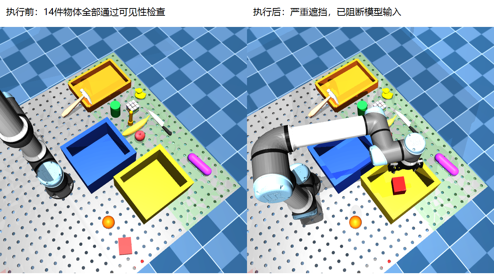

# 新相机规则已接入实际首轮采集：5布局验证完成

记录日期：2026-11-10（America/Los_Angeles）。

## 结论与当前阶段

本轮完成camera_visibility_v6到新首轮采集入口的接线：初始实际渲染与每次暂停观测均执行全14物体轻遮挡门禁。5个固定布局全部通过新的几何资格，完成各1次物理尝试及独立进程审计；旧视角首轮成功1/5，新视角2/5（20%→40%，增加20个百分点）。其中2例改善、1例退步、2例仍失败。

这只是5个已用训练布局的工程配对结果，不代表独立开发集、最终测试集、语言模型语义识别或微调收益。未证明遮挡占历史失败的比例。旧图像从未满足新门槛，因此不能把历史训练数据自动视为已清洗。

执行后4/5画面未达到门槛，全部阻断公开输入；其中964306物理任务已成功，仍保留成功记录。严重遮挡的画面仅用于私有物理审计，不能作为正常模型输入。这修复了“初态清楚，机械臂移动后又遮挡，却继续提供图像”的接线缺口；当前还未实现暂停状态下重新选相机。

## 实际前后画面

这是964009的真实执行截图，只拼接并加标题；原图哈希与独立审计身份一致，已打开目检。右图可见物体进入箱内，但该次任务在返回初始姿态时被路径保护拒绝，按完整任务判据记失败，不能凭截图改判成功。Apple可见率降至2.64%、Flashlight为0；门禁拦截了该画面。

## 固定配对结果

|种子|旧视角首轮|新视角首轮|执行后图像资格|新结果的执行记录|
|---|---|---|---|---|
|964008|失败|成功|通过|成功|
|964009|成功|失败|阻断，仅私有审计|返回初始姿态时路径保护拒绝|
|964012|失败|失败|阻断，仅私有审计|抬升阶段失去双侧接触|
|964294|失败|失败|阻断，仅私有审计|抬升阶段失去双侧接触|
|964306|失败|成功|阻断，仅私有审计|成功|

表中原因来自私有执行遥测，仅用于审计与报告，没有预先作为模型掉落原因标签。本轮语言模型调用0，不等于验证了AI自行诊断能力。

实际初态最差物件可见率分别为88.40%、90.93%、93.97%、87.50%、93.34%，均≥85%。终态检查重新测量全部14实例，保持相同门槛。判定时不改变物理积分状态，独立恢复状态后的测量逐值相同。

完整分母：前轮9个相机条件→5个相机合格、4个拒绝；本轮5/5通过新几何资格→5次新增首轮执行→5/5审计通过→2次完整任务成功。可继续公开采集的终态1个，阻断4个。4个相机拒绝未被补样替换；它们不是本轮5个配对任务的物理失败。

## 具体怎么接入

- `cc_prepare.py`核验相机选择、旧manifest及旧审计，通过`approved_config`和`adopt`只替换camera；布局、颜色、3 mm深度噪声、2%缺失、任务、策略和动作参数保持。移除旧几何资格引用。
- `cc_qualify.py`重新真实渲染全部14物体，使用原投影、噪声点云、抓取跨度、关节/碰撞/路径资格。资格不通过不执行抓取。
- `VisibleSession`拦截真实执行首次渲染；`GuardedSampler`在每次暂停观测采集前复查。严重遮挡、尺寸不足或标定失败则拒绝，不能回退到旧图。
- `cc_worker.py`每布局只执行1次；可见性不合格的终态保留在`private_audit`，并记录`public_input_allowed=false`及`training_eligible=false`。
- `cc_audit.py`独立进程重建初态/终态，核验全部14实例指标、原噪声规则、接触、轨迹与严格几何门槛。没有因为任务成功而跳过遮挡检查，也没有因为遮挡而改写任务结果。

只保留baseline/varied_noisy两场景。新包装类对baseline直接调用原实现，本轮没有重跑baseline。旧冻结采集/训练源码未改，后续多轮恢复采集仍须显式采用新Session/Sampler；本轮完成的是首轮采集接线，尚未将多分支恢复器整体替换。

## 验证证据

|作业|结果|说明|
|---|---|---|
|6394|FAILED/1:0，7项预期断言失败|测试先证实缺失门槛、无回退/配置保持/分母规则|
|6395|FAILED/1:0|发现继承环境被第二次source覆盖，未运行物理实验|
|6396|FAILED/1:0|发现旧audit通名被相机模块遮蔽，未运行物理实验|
|6397|COMPLETED/0:0，17秒|7测试通过；真实清晰/遮挡观测冒烟；独立重建一致|
|6398|COMPLETED/0:0，7分47秒|7测试、11入口导入/代码长度与模块来源检查；5资格/5首轮/5独立审计|

最终15份本地源码/脚本与实际运行manifest SHA256一致；两张原图与独立审计SHA256一致。未知结果未算作失败，本轮unknown=0。正式作业完成后没有改冻结代码，没有重复抓取，没有重启训练。

证据入口：
- [正式结果与配对分母](evidence/pilot/result.json)
- [完整冻结manifest](evidence/pilot/manifest.json)
- [运行日志](evidence/run-6398.log)
- [冒烟结果](evidence/smoke/job_6397/result.json)
- [Slurm最终状态](evidence/sacct.txt)
- [本地源码核验](evidence/local_source_verification.json)
- [原图核验](evidence/image_verification.json)
- [选定结果字段摘录](evidence/selected_outcome_excerpts.json)
- [964008审计](evidence/pilot/audits/964008.json)、[964009审计](evidence/pilot/audits/964009.json)、[964012审计](evidence/pilot/audits/964012.json)、[964294审计](evidence/pilot/audits/964294.json)、[964306审计](evidence/pilot/audits/964306.json)

本地evidence保存了完整manifest、正式结果、审计JSON、资格结果和逐物体门禁记录；结果摘录明确标为摘录。大型积分状态NPZ、完整轨迹和原始传感数据仍位于远端`/home/yeliheng/grasp_server/camera_collection_v1/pilot`，身份列于审计文件。

## 训练状态与下一步

旧微调6198已现场核实COMPLETED/0:0；[训练结果记录](evidence/prior_training_6198_result.json)显示31次更新、124条样例、496个张量变化。它使用旧相机数据，不含本次规则。本轮未验证最终adapter独立重载或模型物理收益，也没有新的语言模型调用、训练更新或SFT导出。

下一步应先补“失败暂停状态下的安全换视角”：保持物理状态和动作预算不变，在允许相机范围内重新寻找清晰画面，仍找不到则明确停止；物理成功的任务可直接结束，不强求再生成模型输入。随后再接入多轮恢复与模型决策，用未使用的布局做预登记比较。当前2/5结果不足以支持直接大规模扩量或宣称微调提升。
