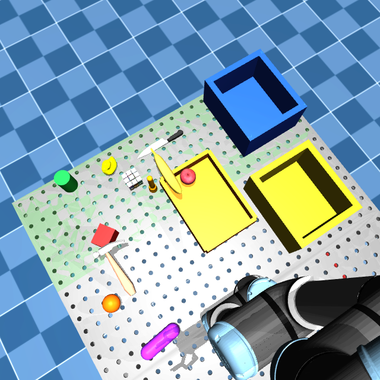

# 联合相机搜索：同候选预算下6/12→7/12，暂不接入控制

在预登记的12个新布局978201–978212上，同一暂停场景比较原搜索和联合搜索，每方法最多256候选。合格布局由6/12增加到7/12（50.0%→58.3%，增加1个布局）；原有6个全部保留。低于预定8布局覆盖门槛，不能进入在线控制或把它解释为任务成功率提高。

## 怎么改进

原搜索逐个检查256全局候选。联合搜索先使用相同128全局候选，没有合格方向时，按拒绝物体数及像素/长短边/可见比例/连通性不足选4个锚点，交错检查最多128局部方向。解析计算能容纳14物体、保留25像素边距的最小视场角，再使用原24像素入画和全部原真实渲染门槛验收。

相机位置、视场角及目标范围未扩大；没有改变7随机/7固定、布局/颜色分布、3mm深度噪声/2%缺失。只有baseline/varied_noisy两个正式场景，本次两组是varied_noisy下的算法对照。评分不读取位姿真值、任务成功或拟合效果。每方法的无效候选也消耗预算。

- 978206：原搜索256候选失败；新搜索第129候选通过。对第30号锚点仅收紧视场角59.881°→56.224°，Apple/Duck可见像素495/500→576/583，原576像素门槛保持。
- 978201：原搜索第233候选通过；新搜索第129候选通过。新方案第58号锚点视场角64.649°→59.613°，Apple像素568→692。
- 其他5个原已通过布局使用相同全局成功视角；剩余5个布局两方案都失败，完整保留，不追加或替换种子。

## 全部分母与代价

|布局|原方案候选数/结果|联合方案候选数/结果|
|---|---|---|
|978201|233，通过|129，通过|
|978202|47，通过|47，通过|
|978203|256，拒绝|256，拒绝|
|978204|256，拒绝|256，拒绝|
|978205|256，拒绝|256，拒绝|
|978206|256，拒绝|129，通过|
|978207|82，通过|82，通过|
|978208|11，通过|11，通过|
|978209|256，拒绝|256，拒绝|
|978210|256，拒绝|256，拒绝|
|978211|51，通过|51，通过|
|978212|24，通过|24，通过|

原方案1984候选、679个测量视角；联合方案1753候选、895个测量视角。联合方案候选数约减少11.6%，但测量视角约增加31.8%。联合方案复用1111个完全相同候选的缓存（包含入画拒绝），其中实际新增测量524次。共享缓存不能当在线速度收益；这次对齐的是候选上限，不是渲染次数或GPU秒数。一个布局增益不足以证明稳定的统计优势。

## 位姿检查与边界

成功视角各采集3个预登记含噪点云，原方案18、联合方案21，共39个估计。原拟合、始终过滤及原版优先修复在这些点云上均接受且准确；两方案最大中心误差分别2.705/2.850mm，最大长轴误差均0.551°。修复分支未被选择，不能证明该分支泛化。

这些是初态胶囊位姿，不是抓放任务或语义识别准确率。没有验证持物、双视角和其他形状。新观察与私有评价均不进入模型/训练/控制，旧初态3次误接受仍未解决。新增抓放、模型、训练均0；每场景初始化500静置步后禁止积分，前后完整积分状态一致。

## 实际验证

- 6608登记COMPLETED/0:0，20秒：17项测试通过，12/12编译通过；198份清单/协议扫描未发现新种子重叠，486份来源哈希冻结，含23份场景XML与历史身份核对。
- 新评分/视场测试先有5项预期行为断言失败，随后通过；本地7测试通过，远端包含预算、缓存、禁止积分和选择策略测试共17项。
- 6610全部12数组COMPLETED/0:0，每项12–50秒，最多2并发，均只执行一次。
- 6616独立CPU审计COMPLETED/0:0，11秒：重算候选生成、入画、资格与全部统计；26个代表拟合条目独立进程复拟合一致。
- 167份远端文本通过整体SHA256传输核验；源码、逐布局文本结果哈希一致。[DELIVERY](evidence/DELIVERY.json)
- 本地独立数值实现重算全部39估计的误差/质量/选择/分类与统计一致。[LOCAL_VERIFICATION](LOCAL_VERIFICATION.json)
- 真实截图已下载并与远端记录SHA256一致，人工查看确认可打开；几何资格不等于人类语义识别已定量验证。

## 真实截图

978206：原256候选未通过，新方法第129候选通过。7个实例随机摆放、7个背景固定；图像来自实际仿真，无AI生成或后期重绘。

## 下一步

[深度异常诊断](../depth_diagnostic_v1/REPORT.md)已在旧978112单案例发现渲染多采样对深度超限的影响，尚未部署。应先把RGB画质与深度/分割的采样设置分开，在新的独立布局和保存的开发状态上检验深度准确性、像素身份、完整资格及位姿误接受，再决定是否接入正式感知。不能直接把单案例修复计入本轮7/12，也不通过补种子凑8个。

最终仍需完整抓放对照证明任务成功率提升。当前不接入在线控制、不开训；未Git提交/推送，公开项目仍为8843852。使用writing-plans、systematic-debugging、test-driven-development、verification-before-completion；完成串行自审，无独立代码审查代理。
